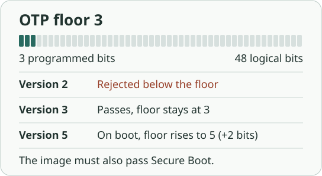

<!-- SPDX-License-Identifier: AGPL-3.0-only -->
<!-- Copyright (C) 2026 RS-Key contributors -->

# Anti-rollback

Secure Boot checks that the firmware was signed by a key the board trusts.
An older signed image can pass that check even if it contains a bug you
have since fixed. The RP2350 boot ROM can reject that image by requiring
a minimum rollback version.

This page covers firmware images. Restoring an old copy of the data flash
is a separate problem. See [Flash snapshot rollback](threat-model.md#flash-snapshot-rollback-the-pin-counter-reset).

## Axis 1 — version (the rollback floor)

Three numbers appear in a release or a signed image:

| Number | Where it lives | What it means |
|---|---|---|
| Release version | Git tag and release notes | Identifies the RS-Key source release |
| Image version | `picotool seal --major … --minor …` | Helps the boot ROM choose between candidate images |
| Rollback version | `picotool seal --rollback N` | Compared with the board's minimum accepted version, called the *floor* |

The signature covers both the rollback version and the list of OTP rows that
hold its floor. RS-Key uses the two default rows. Each chip has its own floor,
which starts at zero on a blank chip.

### How it works in hardware

On a board enforcing Secure Boot, the boot ROM rejects an image whose
rollback version is below the floor. An image at the floor passes the
version check and leaves the floor unchanged. On a normal flash boot of a
valid RS-Key image above the floor, the boot ROM advances the floor to the
image's version. The image still has to pass the other boot checks, including
signature verification.



`ROLLBACK_REQUIRED` closes the versionless path. While it is clear, an
image without a rollback version can still pass Secure Boot. A versioned
image is checked against the floor even with the flag clear. The ROM sets
the flag automatically when it advances the floor on a normal Secure Boot
from flash. The first boot with `--rollback 1` can therefore spend one bit
and make a rollback version mandatory in the same operation. See the
[Raspberry Pi RP2350 datasheet, §5.1.11](https://datasheets.raspberrypi.com/rp2350/rp2350-datasheet.pdf).

> ⚠️ Both the floor and the flag are irreversible. Before enabling Secure
> Boot with a versioned image, or flashing a version above the current floor
> on a secured board, prepare both a signed firmware image and a signed
> [`rsk-wipe`](https://github.com/TheMaxMur/RS-Key/blob/main/rsk-wipe/README.md)
> recovery image at the intended floor. A factory reset leaves OTP
> intact. See [Production](production.md#stage-3--anti-rollback-optional)
> and [OTP fuses](otp-fuses.md).

`rsk otp rollback-require` is the explicit way to set the flag from running
firmware if it is still clear. It requires Secure Boot and confirmation on
the device. It sets the flag without advancing the floor. Check that the
running firmware and your recovery image carry a rollback version before
using it. That check is the operator's responsibility.

### The limit with the default OTP rows

The two default rows hold 48 logical thermometer bits, stored with
redundant copies. Advancing from floor 3 to 5 uses two logical bits.
Routine updates can reuse the same rollback version without spending bits.

**47 is the highest rollback version `picotool seal` accepts with the two
default rows.** The tool requires one spare bit after the version, so
`--rollback 48` requires a third row. RS-Key provisioning and status use
the default layout. See the [picotool seal implementation](https://github.com/raspberrypi/picotool/blob/2.3.1/main.cpp#L5785-L5809).

### Choosing when to raise the floor

Choose a rollback version higher than every vulnerable image that can still
boot under the board's trusted keys. Include any such image you signed at a
higher version but never installed. For example, if the floor is 2 and all
affected signed images carry version 2 or lower, use `--rollback 3`. If an
affected signed image carries version 3, raising the floor to 3 leaves it
eligible.

After provisioning a positive floor, reuse it for routine updates. Sign the
[final combined TrustZone ELF](production.md#2b-sign-and-prove-a-signed-image-boots-before-any-fuse)
with the key the board trusts, then convert the signed ELF to UF2. The
`nix run .#flash` helper stamps `RSK_ROLLBACK`, which defaults to `1`. Set it
explicitly to match the board's floor or the new version you intend to install.

### The marker a tool can read

RS-Key release notes can flag a fix for a downgrade-exploitable bug. The
release workflow copies the marker from that version's changelog section
into the raw GitHub release body, preserving it even if the notes are
shortened. The marker is a single HTML comment, with optional JSON
metadata containing a `reason` string.

```text
<!-- @increase-anti-rollback-epoch -->
```

```text
<!-- @increase-anti-rollback-epoch{"reason": "CVE-1234 was fixed"} -->
```

A release body without the marker carries no request to raise the floor.
The marker supplies no version number. A flasher can show it to the owner,
who chooses the version to sign and install on each board.

## Axis 2 — key (the signature)

Secure Boot matches the public key in the image to an OTP fingerprint in a
valid, unrevoked slot, then checks the image signature. Revoking a key with
`KEY_INVALID` makes images signed only by that key ineligible, even if they
meet the version floor. Revocation works at any floor.

<a id="key-revocation--downgrade-defense-without-the-thermometer"></a>

### Key rotation

On a board provisioned for rotation, `rsk secure-boot rotate` loads a
replacement fingerprint into a free slot. Prove that the fixed firmware boots
with the replacement key at the required version and re-sign `rsk-wipe`.
Then revoke the old slot. Until revocation, both keys are trusted.
See [Rotate a key](signing-keys.md#5-rotate-a-key).

<a id="a-decision-you-must-make-before-the-ceiling"></a>

### Decide at provisioning

The RP2350 has four one-time boot-key slots. With one initial key, at most
three replacements fit. Full `rsk secure-boot lock` permanently revokes every
slot except the one in use and makes OTP pages 1 and 2 read-only from
BOOTSEL. Rotation through the host tools requires skipping that full lock
and leaving a free slot. This leaves the key provisioning path writable
from BOOTSEL. See [Production hardening](production.md#2c-burn-staged).

<a id="when-the-48-budget-is-exhausted--the-ladder"></a>

## When the rollback floor reaches 47

Updates at version 47 still work with a trusted signing key. Older images
at version 47 signed by that same key also remain eligible. If one of those
images must be blocked, revoke its key after a proven rotation, or move to
a board that trusts a fresh key.

## Moving to a new board

A blank chip starts at floor zero. Provision it to trust only a new signing
key and sign the current fixed firmware with that key. The old images fail
Secure Boot because the new board does not trust their signing key. If you
reuse the old key, the new chip's lower floor can make old vulnerable
images eligible again.

A [seed backup](guides/seed-backup.md) restores deterministic, non-resident
FIDO credentials. Resident passkeys, OpenPGP and PIV keys, OATH accounts,
and OTP slots need separate recovery or re-enrollment.

## How to verify all of this

Inspect the file and the board separately.

```sh
picotool info -a firmware-signed.uf2    # file: signature verification and rollback version
rsk secure-boot status                 # BOOTSEL: secure boot, key slots, flag and floor
rsk otp rollback-require --dry-run     # running firmware over CCID: flag and floor
```

File verification checks the signature against the public key in the file.
Booting the image on the target board verifies that the board trusts that
key and accepts the version. On a test board, isolate each refusal case:

| Test image | Expected boot result |
|---|---|
| Trusted signature at the current floor | Boots without advancing the floor |
| Same trusted key, rollback version below the floor | Rejected by the version check |
| Same trusted key, versionless, with `ROLLBACK_REQUIRED` set | Rejected because the version is missing |
| Untrusted or revoked signing key at the current floor | Rejected by Secure Boot |

To test an advance, first prepare the signed firmware and recovery images at
the new floor. Boot the newer image and read back the floor and flag. Try a
previously bootable image sealed below the new floor, then restore the current
image through BOOTSEL. Seeing a UF2 transfer succeed only proves the transfer.
The test is whether the firmware actually starts.
