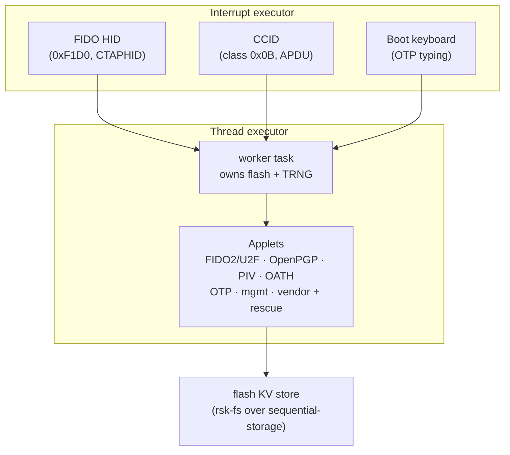
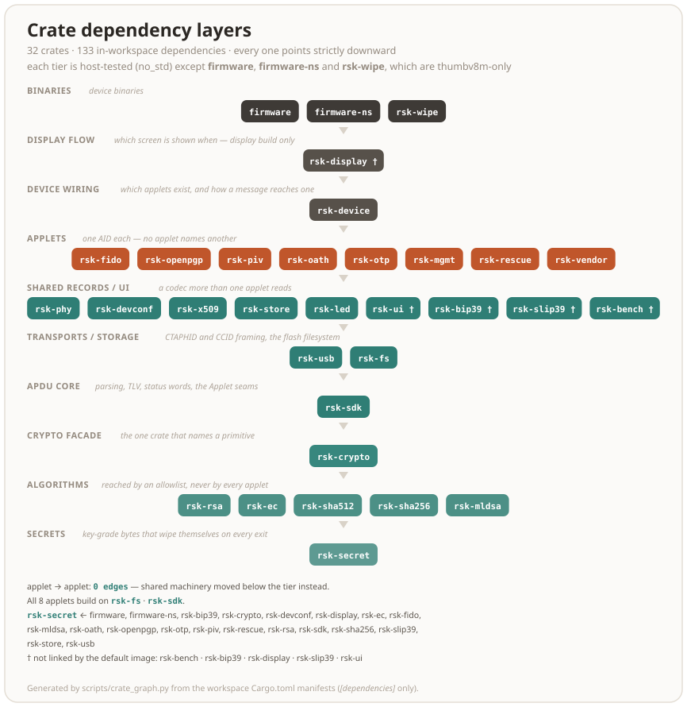

# Architecture

How the firmware is put together, for contributors and the curious. For what
the design does and does not defend against, see the
[threat model](threat-model.md).

The ordinary firmware architecture is described below. The experimental split
keeps the worker and applets Secure and moves transports to Non-secure. Its
[TrustZone boundary](trustzone.md) records resource ownership and the chosen
Secure USB lifecycle observer; the implementation is in place, with physical validation still required.

## The big picture

A composite USB device with three interfaces, eight smart-card applets and
one storage layer. Day to day everything runs on one RP2350 core. The
second wakes only to parallelize RSA keygen (below):

**Two executors.** USB and the transports live on a high-priority
`InterruptExecutor`. The applet dispatch lives on the low-priority thread
executor, in a single *worker* task that owns the flash and the TRNG outright.
Long synchronous work (on-card RSA generation, flash compaction, a touch
wait) blocks only the worker, while the interrupt executor keeps the bus
enumerated, streams CCID/CTAPHID keepalives, and animates the LED. No
mutexes: ownership does the synchronization.

**Why (mostly) one core.** The async executor provides the *concurrency* that
the upstream design used a second core and hand-rolled queues for. Core 1 is
kept out of the transport path and has exactly one job: during on-card RSA
generation both cores race the prime search. Independent random candidates,
each core with its own DRBG stream, feed one shared two-prime pool
(`firmware/src/core1.rs`). Measured, RSA-2048 generation drops from ~8.9 s to
~4.3 s mean (2.07×).

Three details make that work:

- The Fermat-filter modexp (C + asm) executes from SRAM. Two cores running it
  from XIP throttle each other on the shared flash cache (~40% per core,
  measured).
- The key returns the moment the pool completes; core1's last candidate
  finishes in the background.
- A core1 that ever stops answering latches the engine into single-core mode
  rather than stalling the worker (on a `--features core1-stats` build, `INS 0x12`
  on the vendor applet reads the engine's counters and flags; a shipped image
  answers `6D00` — they time the prime search).

Quad-read configuration has a separate interrupt-masked SRAM park handshake.
It changes QMI before core1 starts or after core1 acknowledges that park, and
skips the change while core1 is busy. The probe restores the old mode on mismatch.

Outside keygen, core1 parks in WFE, and embassy-rp brackets every flash
erase/program with `pause_core1()`. That buys less than it looks. The flash
routine is RAM-resident — `write_flash_inner` carries a `.data` link section
and lands in SRAM on a built image — but the pause is not: `pause_core1` and
the `SIO_IRQ_FIFO` handler core1 answers it in are both ordinary `.text`, so a
paused core1 spins in a loop that lives in the flash it is being held off.
Whether the XIP cache covers that loop for the whole of an erase is a question
about this silicon rather than about the driver, and it is registered as
`PLAT-XIP-001 [pending]`, with the board measurement owned by the maintainer.
Until it is taken, "core1's fetches never collide with flash writes" is what
the design intends and not something this repository has shown.

## Boot sequence

Getting to that runtime state has a strict order. The bootrom verifies the
signed image, then the firmware provisions and recovers **all** persistent state
(OTP keys, the KV store, the phy record, the TRNG, the seal migrations and the
one-shot at-rest scrub) *before* it asserts the USB pull-up. That ordering is
load-bearing: `builder.build()` starts host enumeration, and the task that
answers control transfers must be spawned with no blocking work in between, or
the host enumerates a mute device and times out. That is the "blink red / not
recognised until several replugs" report that motivated attaching to the bus
only after everything else is ready.

The TRNG seed is drawn so that it can fail only closed: a draw holding an all-zero
192-bit block, the part's answer to a failed health check, is drawn again, and
after three such draws the board halts there, before the pull-up, rather than seed
the DRBG from a constant; it wipes the seed and the dead stack first, and nothing
else holds a secret yet. The 64 KiB reseed draws the same way; failing, it leaves
the operation in flight to the DRBG as its checked seeds left it and queues a warm
reboot, which the worker runs through its RAM scrub, and the boot after it draws
the seed afresh.

## Crates

The workspace splits along a strict dependency gradient: the `firmware` binary
is thin glue over the applet crates, which build on a handful of host-tested
platform libraries. The per-crate detail is in the table. The shape is:

**No applet names another applet — the count is zero, in code and in the manifests.** This page used to name three cross-edges (`piv→openpgp`, `openpgp→rsa`, `piv→rsa`), only the first of which was one applet reaching sideways; the manifests carried **six** — `fido→mgmt`, `fido→rescue`, `openpgp→mgmt`, `piv→mgmt`, `piv→openpgp`, `otp→mgmt`. The machinery under each moved *down* instead: the phy record into `rsk-phy`, the DeviceInfo record into `rsk-devconf`, RSA into `rsk-rsa`, and the EC key type both card applets seal (`PrivKey` over `Curve`, the `[curve_id] ‖ scalar` blob) into `rsk-ec`. Six `rsk_<applet>::` mentions do survive across the applet tier, every one inside a comment where one applet explains its ordering by pointing at a sibling — a cross-reference, not a dependency.

What holds that now is `deny.toml`: each applet crate is banned except behind the composition roots that wire it, so a sideways edge fails the `cargo deny` row of the gate instead of waiting on a reviewer. The same stanza keeps a hash backend to `rsk-crypto` and puts `rsk-ec`/`rsk-rsa` behind a named allowlist. The drawing above is generated by `scripts/crate_graph.py`, which checks the shape from the other side — every member placed in a tier, every edge strictly downward — and fails the gate when the committed SVG has drifted from the manifests.

| Crate | Contents |
|---|---|
| `firmware` | Secure board glue and the ordinary firmware: board bring-up, USB descriptors, executors, the worker, OTP fuse access, LED, BOOTSEL touch |
| `firmware-ns` | TrustZone Non-secure USB classes, transport framing and TIMER1; Secure owns the controller, worker and applets |
| `rsk-wipe` | the second flashable image: a RAM-only flash erase for clean-slate testing — wipes all of flash, leaves a `NUKE` eyecatcher, reboots to BOOTSEL. Runs from SRAM because erasing the sectors a flash-resident image executes from would crash on return |
| `rsk-sdk` | APDU parsing (cases 1–4, short + extended), BER-TLV, status words, the `Applet` trait + dispatcher, and the seams a board hands every applet: `Rng`, `UserPresence`/`Presence` |
| `rsk-fs` | the flash filesystem: 16-bit file ids over two `sequential-storage` KV partitions (main + high-churn counters), ACLs, metadata records |
| `rsk-crypto` | one wrapper over RustCrypto: hashes, HMAC/HKDF, AES-CBC/CFB/GCM, ChaCha20-Poly1305, PIN KDFs, HMAC-DRBG, ML-DSA-44/-65/-87 (`rsk-mldsa`) / ML-KEM, base64url, CRC |
| `rsk-mldsa` | stack-optimized ML-DSA (FIPS 204) for all three parameter sets: streams the matrix A on the fly (one polynomial resident, not the full k×l) so even ML-DSA-87 fits the RP2350 stack where the by-value `fips204` crate's -65 overflowed it. `no_std`, no alloc, no `unsafe`; checked byte-for-byte vs NIST ACVP KATs, with Kani proofs over the reductions and rounding |
| `rsk-sha512` | SHA-512/384 for the Cortex-M33, byte-identical to `sha2` but a compact rolled compression (~0.9 KB) that fits the XIP cache instead of `sha2`'s ~28 KB unrolled body — ~4× faster end-to-end on a FIDO getAssertion, with the identical digest, so `hmac`/`hkdf` compose over it byte-for-byte |
| `rsk-sha256` | SHA-256 with unrolled register rotation and a separate speed profile for the Cortex-M33; byte-identical digests through the same RustCrypto HMAC/HKDF contracts. Chaining state and the complete working schedule live in `Secret`; returned compiler temporaries remain covered by the Secure stack sweeps. |
| `rsk-secret` | key-grade bytes in a type that wipes itself: `Secret` (no `Copy`, `Clone`, `Debug` or `==`, and zeroized when it drops — on every exit, a `?` included) and `WipeGuard` for a borrowed buffer that outlives the scope. The bottom of the graph, so every crate that holds a secret can name it |
| `rsk-usb` | the CTAPHID reassembler/framer, CCID state machine and shared transport/worker ABI, transport-agnostic and fully host-testable |
| `rsk-fido` | FIDO2 (CTAP 2.1) + U2F: credentials, clientPIN (protocols 1+2), credManagement, extensions (hmac-secret, credProtect, credBlob, largeBlobs, minPinLength), enterprise attestation, seed backup + soft-lock vendor commands |
| `rsk-openpgp` | OpenPGP card 3.4: DO model, PW1/RC/PW3, import/generate, PSO, AES PSO, certs, Yubico's key attestation (`ATTEST`, DO `FC`) — EC + RSA-2048/3072/4096 |
| `rsk-piv` | PIV: 24 key slots + F9 attestation, management-key auth, generate/import/sign/ECDH, on-card X.509 through `rsk-x509` |
| `rsk-oath` | YKOATH protocol: TOTP/HOTP, touch-required accounts, access codes |
| `rsk-otp` | Yubico OTP slots ×4: CCID command surface + the keyboard frame protocol and typed-ticket generation |
| `rsk-mgmt` | the YubiKey management applet: the CCID command surface for READ/WRITE CONFIG (the record itself is `rsk-devconf`), served over both CCID and CTAPHID |
| `rsk-rescue` | recovery/provisioning applet: identity, the phy config record (codec in `rsk-phy`), flash info, secure-boot status, attestation key, reboot, the one OTP-lock write |
| `rsk-store` | the `rsk_fs::Storage` backend the device runs: two `sequential-storage` map partitions (credentials vs. the hot counters), the counter-FID routing, and the scrub lap that physically destroys superseded secrets — generic over the flash, so the fuzzer can cut its power and the emulator can mount a file |
| `rsk-device` | the applet wiring both the firmware and the emulator run: which applets exist, what capability gates each, and how a CTAPHID or CCID message reaches one — the board's own parts behind a `Hooks` trait. Also the presence-scope arbitration (`presence`): which transport owns the one button, whose cancel may end its wait, and the `spent` latch, with the button and clock behind a `Board` seam. And the reboot slot (`reboot`) the worker takes a queued reboot from and the trusted display parks on, pending from the request until the reset |
| `rsk-vendor` | the vendor AID: the persisted test counter, SET/GET LED, the reboot request, and — gated out of every shipped image — core1 stats and the measurement benches; the hardware behind a `Platform` the firmware fills in |
| `rsk-rsa` | the RSA family: the key type, key generation, the sealed CRT layout and its blinded, fault-checked private operation, PKCS#1 v1.5, the `7F49` public-key DO — over vendored C/ARM-asm modular exponentiation behind one FFI fn (host build uses a pure-Rust fallback). The OpenPGP and PIV applets add only their own framing and seal I/O |
| `rsk-ec` | the EC family: the private key both card applets seal (`PrivKey` over `Curve` — the persisted `[curve_id] ‖ scalar` blob), its ECDSA/EdDSA signing, `d·G` public-point derivation and ECDH, the `7F49 { 86 }` public-key DO, and underneath them the fixed-base Lim–Lee comb `k·G`/`d·G` that FIDO, PIV and OpenPGP all sign on — bit-identical to the RustCrypto generic path, several× faster on the Cortex-M33 |
| `rsk-led` | the `EF_LED_CONF` codec for the status-LED config block, shared by the firmware and the `rsk led` host tool |
| `rsk-devconf` | the `EF_DEV_CONF` codec: the Yubico DeviceInfo record — which applications are enabled, the capability vocabulary, the validate/merge/trim write path and the READ CONFIG response built around it. Written by four command surfaces (CCID, the OTP keyboard slots, CTAPHID, the FIDO vendor config-write), so it sits below all of them rather than inside the management applet |
| `rsk-x509` | the on-card X.509 builder: a backward DER writer, the `C=ES, O=RS-Key` names, the SPKI for EC, RSA and RFC 8410 keys, the standard extensions (an attestation statement goes without keyUsage) and any the caller adds, and the signature. PIV's F9 and attestation certificates go through it, and OpenPGP's attestation statements, so it sits below both card applets rather than inside the first that needed it |
| `rsk-phy` | the `EF_PHY` codec: the PicoForge-compatible device-config TLV record — USB identity, LED wiring, the interface mask — plus its clamped load and its read-modify-write save. Read by the rescue and FIDO applets, `rsk-device`, `rsk-display` and the boot path, so it sits below all of them rather than inside one |
| `rsk-bench` | robust summary statistics (median, MAD, a separate cold sample) for the on-device latency harness. Steady-state timing on the RP2350 is XIP-cache sensitive to ±~30 ms, so a mean fakes regressions; compiled in only under the `bench` feature, never into a shipped image |
| `rsk-bip39` | BIP-39 mnemonic encode for the trusted display's recovery-phrase screen; `display` build only |
| `rsk-slip39` | SLIP-39 (Shamir) share encode for the same screen, mirroring the host `shamir_mnemonic` exactly so `rsk backup restore` recombines; `display` build only |
| `rsk-ui` | the trusted-display UI model (operation prompts, untrusted relying-party-string sanitizing, Allow/Deny button geometry) plus its compact retained scene and 8-row rasterizer; compiled only into the `display` build |
| `rsk-display` | the trusted display's *flow* — which screen is shown when, the PIN pad, the browse modals, the Approve/Deny wait — over a panel and a touch controller it takes as type parameters, so the firmware drives an ST7789 with semantic damage + two-band DMA and the emulator replays the same retained scene into a window; `display` build only |

Everything except the three device binaries is hardware-agnostic and runs the full
test suite on the host ([testing.md](testing.md)).

## Flash layout

Two KV partitions at fixed offsets (`firmware/memory.x`): the main store, and
a small separate partition for the per-operation counters so their churn
never forces compaction of long-lived records. Files are 16-bit ids. Each
applet owns disjoint ranges (FIDO `0x10xx/0xCxxx/0xCFxx/0xD0xx`, OpenPGP DO
mirrors, PIV `0xD1xx/0xD2xx/0xD4xx/0xD6xx`, OTP slots `0xBBxx`, phy/rescue `0xE0xx`) and a
reset wipes exactly its own predicate, never a range shared with another
applet.

Both regions sit behind one RP2350 **partition table** entry carried in the
shipped image: the USB bootloader is denied read and write over
`__kvmain_start..__kvcnt_end`, while secure code — the running firmware,
`rsk-wipe`, the rescue applet — keeps `rw`. The table is derived from those
linker symbols rather than restated, so it follows `FLASH_SIZE`/`KVMAIN` on its
own ([build.md](build.md#the-partition-table)). What it is and is not worth:
[threat-model.md](threat-model.md#flash-snapshot-rollback-the-pin-counter-reset).

The board owns the SHA-256 peripheral behind a private `RefCell`. It hashes
public journal bytes before mutations of a mounted directory, including a fresh
erased-tail check. Initial journal authentication and root-key HMACs use the
software crypto path; an engine failure refuses the operation. Bulk `SharedFlash`
reads use the existing Secure Core0 XIP FIFO access, without DMA or additional
bus-master permissions. The host-tested driver bounds the transfer, drains stale
FIFO words and checks final count, flash-relative address and empty FIFO.

Key sealing at rest: `kbase = HKDF(serial_hash, otp_master_key)` keys
AES-CBC for the FIDO seed (tagged formats: plain vs OTP-rooted generation)
and AES-GCM for PIV keys. OpenPGP keys sit under the PIN-wrapped DEK chain.
When the OTP master key gets provisioned later in a device's life, a boot
pass and lazy PIN-verify hooks migrate every sealed object to the new root
without losing data. Until that burn the root derives from on-chip state
alone, which an attacker with full flash and chip access could reconstruct.
[threat-model.md](threat-model.md) covers what at-rest sealing does and does
not buy before provisioning.

One sealed object worth spelling out is the FIDO credential box. It doubles as
the opaque credential ID a relying party stores, so its size caps the reported
`maxCredentialIdLength` (748):

The 42-byte resident id carries a **version byte** at offset 8, a reserved
header byte outside the `[10..42]` HMAC chain, so it never changes the id's
entropy. It is `1` (v2) for every resident credential created since RS-Key
`0x0806`: a v2 credential derives its signing key, hmac-secret and largeBlobKey
from this **stable** id, so an `updateUserInformation` reseal (which draws a
fresh box IV) no longer rotates them and the relying party's stored public key
keeps verifying. Resident credentials from older firmware carry an implicit `0`
(v1) and keep deriving from the box, so an already-provisioned device stays
compatible across the upgrade.

## Capacity — why the flash is mostly empty

Storage v2 keeps the partition offsets and the 4078-byte value ceiling. KVMAIN
still carries the existing payload map. The 128 KiB KVCNT window now contains
two 44 KiB main-directory journals and two 20 KiB counter banks. The directory
signs the complete live FID set; each entry authenticates its partition, epoch,
generation, length and full payload. CRC-discarded expected values and damaged
bytes resembling legacy layouts fail as storage errors. Counter traffic leaves
KVMAIN and the main-directory journals unchanged.

Main writes reserve a candidate before publishing an authenticated intent,
verify that exact candidate, and then publish to both journals. Recovery
finishes a complete candidate or cancels its reserved span before allowing GC.
Counter values and their authority are committed together and mirrored before
success. From `0x0B66`, counter reads and write admission reuse authenticated
locations only after freshly checking both complete physical banks. The used
prefix is hashed and every byte of the erased tail is checked; changed bytes
trigger full replay and recovery. Fingerprints are bound to the current root
key, epoch and root arm, and requested values retain their full MAC check.
Fingerprints are formed from the same bytes as the authenticating scan, not a
second read of potentially changed data. Mutation discards the mount before
programming; verified closure seeds the next mount. Invalid occupied suffixes
retain authenticated progress as a minimum generation; an older replica cannot silently replace that progress.

From `0x0B83`, each directory digest prepares one local HMAC template for its
fixed root key. Every original frame is still authenticated. Payload reads,
root observations, rollback floors and publication order are unchanged.
The template lives only in returned frames covered by the Secure stack sweep;
it never enters the mounted store. Persistent bytes are unchanged. The digest
loop stays out of line so the template does not enlarge its callers' frames.
The P-256 ECDH multiplication also executes from existing Secure RX SRAM;
from `0x0BA8`, its complete point addition and field inversion do too.
The addition's upstream monomorph has a linker size assertion: a dependency
or code-generation change requires reviewing the relocation again.
Its scalar arithmetic and point validation are unchanged. P-256 and P-384
peer decoding use separate frames to keep their workspaces out of other curves.
P-384 addition, subtraction and doubling stay out of line on 32-bit targets;
these are the existing constant-time field operations, with no change to point
validation or scalar handling. The Fiat and 64-bit backends keep their inlining.

From `0x0BA8`, PIN retry bytes and AES-GCM-sealed HOTP moving factors use private
counter-journal buckets. The complete public PIV/OpenPGP retry records live in
separate private counter entries; a durable tombstone prevents legacy fallback
after deletion. Verifier-bearing PIN presence probes authenticate their main-file owner
without fetching retry bytes. Each slot names the main record's publication
generation; changing or deleting that record invalidates the old slot. Root
re-keying preserves publication generations. PIN verifiers and OATH secrets
remain in the main payload map; the buckets contain neither. A retry update
keeps all other bytes of the PIN record intact. HOTP reads combine its sealed
credential with its separately sealed moving factor, and rename materializes
that effective value before replacing the credential.

Legacy records remain authoritative until a matching bound slot is published.
Both counter banks must acknowledge an update before comparison or a code can
escape. A malformed, unreadable or unauthenticated bucket is an error, never
permission to use the legacy value. Counter authority retains its authenticated
live state across read failures and admits only its staged writes. Mounted
PIN/HOTP reads fetch the requested entry and payload in both banks, require
byte-identical copies and authenticate the value against that live authority. As with
the main payload map, unrelated historical records are checked at mutation and
recovery boundaries, rather than on each addressed read. Every update still
checks both complete banks before and after publication; the original four
counter APIs retain their complete-bank reads.

Mounted reads retain only nonsecret authentication tags. Each read fetches the
root again, authenticates the current authority and reads the physical payload.
An unchanged entry may reuse its payload tag across unrelated publications,
but only while it exactly matches the current authenticated directory entry;
the fresh mount proof binds it to the current authority. A payload tag already
bound to the current authority authenticates both together. After a successful
read across an unrelated publication, the payload tag is refreshed to that bound.
The counter authority MAC covers a SHA-256 digest of the entire canonical
directory, plus its epoch, root arm and sequence. Persistent directory MACs and
checkpoint encodings are unchanged.
Warm mutations compare fresh complete-bank SHA-256 digests with the verified
mount and check its authority MAC with the current key. Append confirmation
verifies the saved prefix MAC before comparing the intended and physical digests.
No root, derived key or keyed hash state survives the call. Private reads do
not reread unrelated journal bytes; writes and recovery authenticate both full
banks, including their erased suffixes. A changed private value is refused on
read even when both banks are replayed, and reading an unchanged value cannot
lower another counter's retained floor. A complete flash replay across cold
boot retains the limitation described in the threat model. Earlier v2 builds reject the new private
FIDs during mount, so downgrade cannot expose the old embedded counts.

The bucket layout keeps all 255 OATH slots and all 256 FIDO counters. Directory
entries use an unaligned byte representation for their generation in RAM to
make room for the larger counter index; the 32-byte on-flash entry is unchanged.
The original four-counter legacy import manifest also remains unchanged.

The private on-flash FIDs and value layouts are fixed:

| FID | Value |
|---|---|
| `CD00` | Five 16-byte slots: legacy PIV, legacy OpenPGP, FIDO, device and OATH PIN retries |
| `CD01`–`CD20` | Eight 48-byte HOTP slots per bucket, in credential-FID order from `BA00` |
| `CD21`, `CD22` | PIV and OpenPGP retry records: `01` followed by the complete record, or the one-byte tombstone `00` |

A bound slot starts with the owner's 8-byte little-endian publication generation,
then a one-byte value length and that many value bytes; unused bytes are zero.
An unused slot is entirely zero. PIN slots hold up to three retry bytes; HOTP
slots hold the 36-byte nonce, ciphertext and GCM tag. The last HOTP bucket's
eighth slot is unused because `BAFF` belongs to the OATH access code.

From `0x0B70`, main and counter journals retain the SHA state of complete public
metadata blocks from the authenticating scan. Before extending that state, the
partial block is reread and checked against the root-bound prefix fingerprint.
The exact intended append extends this state in RAM. After both publications,
each complete physical bank is read afresh: its occupied prefix must match the
expected fingerprint and every tail byte must remain erased. Only then can the
new append position be reused. This replaces per-record closing replay without
accepting a changed historical prefix, a different append or a hidden suffix.
No root key or payload plaintext is retained. Cold mounts, recovery and
compaction keep the full replay path; missing proof state uses that path too.
A GET RESPONSE that only drains a prepared answer leaves the public OTP HID
status mirror alone. Every new APDU and OTP operation still refreshes it; the
mirror is not used to authorize operations or validate stored values.

From `0x0B05`, TrustZone places shared memory-copy and clearing helpers beside
the verifier in read-only Secure SRAM. Their instruction bodies are unchanged;
startup copies them before use under the existing executable-memory policy.
Build `0x0B66` groups the X25519 ladder, field multiplication, subtraction and
squaring into one aligned 8 KiB XIP cache way. The arithmetic stays unchanged;
neither SRAM nor cache-control permissions change. Ed25519 uses dalek's existing
constant-time base-point tables, with `zeroize` retained and no heap required.
The tables occupy 30 KiB of flash. The store crate uses speed optimization,
as the shared SHA-256 core already does.

From build `0x0ACF`, Main keeps its complete authenticated version directory
in protected RAM. A warm read freshly checks the root, verifies its binding to
the mounted directory, and authenticates the complete requested payload against
its expected entry. The complete directory also authorizes absence. Neither root
keys nor payload plaintext are cached. Before reusing a mounted directory for
mutation, full physical-journal fingerprints are checked. Otherwise authenticated
journal resolution and recovery precede mutation.
From `0x0B55`, a verified mount also retains the append offsets and chain heads.
After the physical-journal check, a healthy payload map can reuse this position
without replaying the journal again. The completed write's authenticated
closure seeds the next read mount; errors clear these hints. Payload repair
still takes the original resolution path, and no root key or payload is retained.
From `0x0B66`, unpublished-value retirement first performs an unrepaired,
read-only walk. Known FIDs exclude historical bodies from this walk without
warming their key pointers; included candidates still pass the full CRC.
All published values are authenticated before any deletion or subsequent GC.
Deletion retains the post-cleanup validation; a walk that changed nothing needs
only the pre-mutation validation. The ordinary item iterator stays separate
so the filtered walk does not enlarge lookup futures. Payload seals and
persistent formats are unchanged.
A separate mounted authority tracks the exact epoch, root arm, sequence and
directory digest through Prepare, Commit, Abort and rekey. Errors and remounts
clear acceleration hints but retain this floor; the first verified publication
closes its predecessor before a later replica write can fail. Ready is cleared
before any directory change. Unrelated journal or payload-map damage need not
interrupt a warm read of known correct data; recovery and mutations check that
media before consuming it. The cold-start rollback limitation still applies.

From `0x0AD0`, a ready read lends the map only the requested record's aligned
scratch span, under a wipe guard. Cold reads and mutation paths clear the whole
scratch before reusing a mount; warm reads wipe everything the map could have
filled, including padding and partially completed failing reads. A fallback drops
the bounded guard before full-buffer lookup and cleanup. Absence borrows no
scratch. Fresh root checks and complete value authentication remain required.

From `0x0AD6`, a read-tag miss validates the same checked record geometry, then
borrows the full scratch under its wipe guard. An uncached map lookup can read
larger unrelated values before finding the requested FID. This avoids a small
buffer failure, repeated binding proof and full-buffer retry, and lets the first
verified value seed its read tag. Tag hits retain the bounded span and the
existing recovery checks.

TrustZone build `0x0ADC` also unrolls SHA-256 schedule expansion. A placement
hint avoids rebuilding the expanded schedule solely for its final wipe. The hint
has no security role: the complete 64-word schedule and chaining state remain
in `Secret`, and cleanup does not depend on optimization. Full MAC frames, fresh
Root reads, rollback floors and persistent record formats are unchanged.

TrustZone build `0x0ADB` fully unrolls the software SHA-256 rounds and places
the unchanged HKDF-SHA256 and HMAC-DRBG helpers in Secure RX SRAM as well.
The full 64-word schedule and chaining state remain in `Secret`. The complete
Secure dead-stack sweep uses 32 stores per pass with the same bounds and tail.
Additional RX code reduces the core0 stack span; data and Non-secure RAM do not
grow. Full record verification, fresh Root observations, rollback floors,
DRBG Generate/reseed boundaries and cleanup before publication are unchanged.

TrustZone build `0x0ADA` executes the unchanged SHA-256 compression/finalization and HMAC template functions
from the existing Secure RX SRAM region. Trusted Reset copies this code together
with the existing RAM routines before enabling the read-only executable mapping.
The region grows by 1824 bytes on the Waveshare 4M test image, reducing the
core0 stack span by the same amount; data, BSS and Non-secure RAM are unchanged.
Full SHA-256 input hashing, MAC frames, fresh Root reads and both Secure stack
sweeps retain their existing contracts. No keyed context or plaintext is cached.

Build `0x0AD3` prepares one operation-local HMAC context for the
full mounted binding and complete payload checks, using the prefix reuse from
[RFC 2104 section 4](https://www.rfc-editor.org/rfc/rfc2104.html#section-4). The context stays in returned
stack frames covered by the Secure sweep; no keyed state is retained for a
later backend read, which derives its root afresh. Authentication frames and
persistent records are unchanged.

From `0x0AD5`, Main can retain 32 read tags and one mounted-binding tag, with
their exact public metadata, in protected RAM. Every admitted backend read still
reads OTP and applies the original arm and latch rules. A miss derives the persisted
key and verifies the full binding and record MACs before seeding a tag from that
same OTP observation. A hit instead verifies a full 32-byte root-key HMAC:
`RSKV2RM1 || serial_hash || bound[100]` for absence, or
`RSKV2RD1 || serial_hash || bound[100] || entry[32] || SHA256(value)` for a value.
The bound contains the canonical snapshot and its full mounted-binding tag.
Every payload byte is hashed before any requested prefix is returned; a miss
reuses the digest already verified by the record MAC. Root bytes are wiped
before map I/O. No root, derived key, plaintext or keyed state survives a read
in Main or KeySource; returned crypto frames remain covered by the Secure sweep.

CRC or missing-map recovery first verifies the original observation's mounted
tag, then freshly reads and derives the root again. The existing full binding
proof checks this second observation before recovery reads payloads. A cached
payload-tag mismatch refuses immediately. Main clears the read tags with its
other hints before mutation and on read errors, retaining the authority floor.
These tags have no persistent representation and do not change journal or record formats.

Boot mounts authority before scanning or provisioning applets. Wholly blank
media and readable legacy stores are initialized or imported automatically.
Read faults, damaged v2 authority and malformed legacy page layouts enter CCID
rescue mode; [attended commands](guides/cli.md#storage-initialization-and-upgrades)
remain available for recovery.
Import freezes the main set and four routed counter values in a signed manifest,
verifies backups in KVMAIN before counter erasure, and resumes after interruption.
The legacy counter reader treats the exact SDK E10 256-byte `0xEF` suffix as
erased only when the remainder of that final sector is unused. Its view cannot
write or erase; authenticated banks read the actual flash bytes.
Backend-owned FIDs `CEF8..CEFD` stay outside the public map and dynamic-file
budget. The activation witness survives applet resets. Pre-OTP authority is
re-keyed before the page-58 latch can report migration complete.

The KV store is 1.5 MB by default whatever the `FLASH_SIZE`, so a larger flash only
grows the code region, most of which no firmware writes ([build.md](build.md)). That
is deliberate. (A 2 MB board is the one exception: it shrinks the main partition via
`KVMAIN` to leave room for code — still far more than a key ever fills.) A security key's maximum *logical* state is small and hard-capped:
`MAX_RESIDENT_CREDENTIALS` (256 passkeys), `MAX_DYNAMIC_FILES` (1280 files, one
budget shared by every applet), `MAX_OATH_CRED` (255), plus a handful of
OpenPGP/PIV slots. The passkeys dominate the bytes — a file-count ceiling is not
a size ceiling — so a fully provisioned device fills only a few hundred KB, well
under the 1408 KB main partition. Growing the store to "fill" a 16 MB board would buy nothing usable: it
lengthens the `sequential-storage` scan behind every cold boot and absent-key
probe (the present cache exists to dodge exactly that full-partition ~0.2 s cost),
and forces the logical caps (and the RAM/stack buffers sized to them) up for
capacity no one reaches. Empty flash here is headroom, not waste.

## Device identity

USB VID/PID, product strings and the reported firmware version are
compile-time knobs ([build.md](build.md)). The default is RS-Key's own
identity: VID:PID `0x1209:0xF1D2` (pid.codes), manufacturer "RS-Key",
product "RS-Key Security Key" (the `RSKey` preset). An opt-in `VIDPID=Yubikey5`
preset builds the Yubico interop flavor (`0x1050:0x0407`, reader name "Yubico
YubiKey") for the tools that auto-recognize the device purely by that reader
name. A flash-resident *phy* record can override VID/PID and the product
string at boot (the store mounts before the USB builder runs for exactly this
reason). FIDO tools find the device by HID usage page, CCID tools by the
reader name. From build `0x0A8A`, the default PID is the allocated `F1D2`
instead of the former test PID `0001`. An existing explicit VID/PID override in
`EF_PHY` remains effective after an upgrade, including `1209:0001`; firmware
does not rewrite that record. Keys and credentials are unaffected.

## User presence

One presence button (BOOTSEL by default, or `PRESENCE_PIN`), shared by all
applets through `rsk_sdk::UserPresence`, which the firmware implements once:
FIDO operations, OpenPGP UIF, PIV touch policies, OATH touch accounts, and OTP
slot typing (1–4 presses select the slot) all gate on it. The trait has two
asks, because a screen answers them differently: `request` for a smartcard
touch policy, one per signature, and `request_ceremony` for a ceremony a host
raised — a CTAP2 command, or the pinpad's "Allow host PIN entry?" gate — which
alone can be cancelled mid-wait (`CTAPHID_CANCEL`) and so alone can answer
`Presence::Cancelled`. The no-touch build (`--features no-touch`)
auto-confirms. For test rigs, not for daily use.

## Without a board

`tools/emu`, a workspace of its own, serves what a host sees of the device —
CTAPHID reports and CCID messages over TCP, or the whole USB device over USB/IP —
from one of two backends. The default runs the applet crates on the host through
`rsk-device`, the wiring the firmware runs, with the worker's sequencing written a
second time. `--image` runs the firmware ELF itself: cold-booted through the real
bootrom on picoem's RP2350 cores, over the chip models in `tools/emu/src/image/`
(USB controller, OTP, QMI and NOR flash, SHA-256, TRNG), with an emulated host
controller on the far side of the bus. [testing.md](testing.md) says what each
proves.

## Provenance

RS-Key reimplements the applet behaviour, file layouts and protocol surface
of [pico-keys](https://github.com/polhenarejos) (AGPL, see
[NOTICE](https://github.com/TheMaxMur/RS-Key/blob/main/NOTICE)) in Rust,
replacing the C HAL/runtime/transport stack with embassy and RustCrypto:

| was (C) | is (Rust) |
|---|---|
| pico-sdk runtime + TinyUSB | `embassy-rp` + `embassy-usb` |
| mbedTLS | RustCrypto (`p256/p384/p521/k256`, `ed25519-dalek`, …) + our own `rsk-rsa` |
| TinyCBOR | `minicbor` |
| bespoke wear-leveled flash writer | `sequential-storage` |
| core0/core1 + queues | one async executor pair; core1 = a keygen math engine only |

Where the two implementations deliberately differ (at-rest sealing, seed
PIN-wrapping, OTP provisioning policy, several upstream bugs not carried
over), the divergence is a documented design decision. See
[threat-model.md](threat-model.md) and the crate docs.
