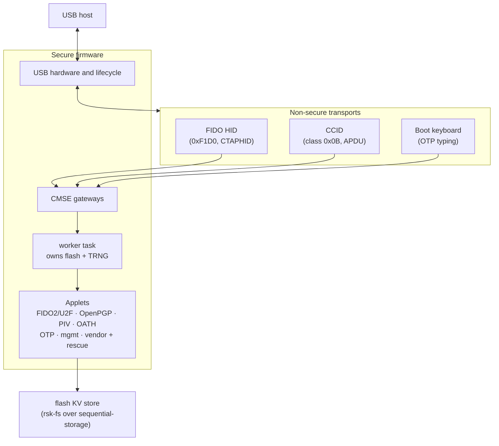
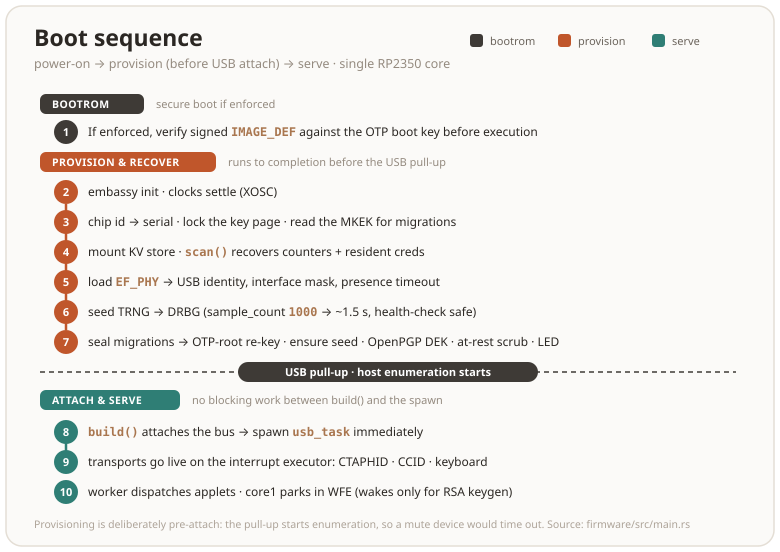

# Architecture

RS-Key is a composite USB authenticator. Its applets handle CTAP, smart-card
and OTP commands and share a flash-backed store. This chapter follows a
request from USB to the applet, then describes boot, storage and board input.
See the [threat model](threat-model.md) for security assumptions.

## The big picture

USB classes pass command bytes to the Secure worker. The worker dispatches
commands to the applets, which share a flash-backed store.

### RSA on core1

Core0 serves USB and runs applet commands. During on-device RSA key
generation both cores search for primes. Each core draws candidates from
its own DRBG and submits primes to the same pool in
`firmware/src/core1.rs`.

- The Fermat-filter modexp (C + asm) executes from SRAM. Two cores running it
  from XIP throttle each other on the shared flash cache (~40% per core,
  measured).
- The key returns the moment the pool completes; core1 cancels its last
  candidate at a Lucas progress boundary and scrubs it in the background.
- A core1 that ever stops answering latches the engine into single-core mode
  rather than stalling the worker (on a `--features core1-stats` build, `INS 0x12`
  on the vendor applet reads the engine's counters and flags; a shipped image
  answers `6D00` — they time the prime search).

Quad-read configuration has a separate interrupt-masked SRAM park handshake.
It changes QMI before core1 starts or after core1 acknowledges that park, and
skips the change while core1 is busy. The probe restores the old mode on mismatch.

Outside keygen, core1 parks in WFE, and embassy-rp brackets every flash
erase/program with `pause_core1()`. `write_flash_inner` runs from SRAM.
`pause_core1` and its `SIO_IRQ_FIFO` handler are in flash-backed `.text`.
`PLAT-XIP-001` tracks whether the XIP cache covers the parked core's loop
throughout a flash erase.

## TrustZone

Every authenticator build splits core0 into Secure (S) and Non-secure (NS)
execution. NS handles USB classes and framing, which accept traffic from an
untrusted host. S owns the USB controller, applets, private keys, storage,
and the inputs that authorize a command. The Secure worker runs in
`SWI_IRQ_0`. The NS USB executor can send keepalives while the worker runs
crypto. Core1 helps search for RSA primes and otherwise parks.

Assume an attacker can run arbitrary privileged NS code, including interrupt
handlers. It can forge channel IDs, replay messages, call gateways directly,
read plaintext that passes through the transport, or stop serving USB. An
APDU PIN that crosses NS is visible to that code. A PIN entered on the trusted
display stays in S. S checks button and touch input directly. The Secure applets verify PINs
and management-key authentication before using private keys.

The trusted computing base includes S startup and access policy, the CMSE
gateways, USB hardware front-end, applets and parsers, crypto, storage and
board I/O. TrustZone separates this code from NS. The [threat model](threat-model.md)
describes the trust placed in S code, the RP2350 and external flash.

### Resource ownership

| Resource | Secure owner | Non-secure access |
|---|---|---|
| Flash, SRAM and core0 | S startup, worker and stacks, linker-defined NSC veneers, flash programming and QMI/XIP controls | NS code, vectors, SRAM and stack. Calls into S use the declared veneers. |
| Core1 and cross-core controls | RSA engine, its DRBG, stack, mailbox, and SIO launch and pause handshakes | No access to the engine or its reserved SIO resources |
| USB controller | USBCTRL, DPRAM, endpoint buffers and layout, IRQ masks and acknowledgement, bus epoch | Bounded endpoint operations and copies of packets and events |
| USB classes | S validates the persisted USB identity and interface mask | CTAPHID, CCID, OTP HID, keyboard framing and class keepalives |
| Timers | TIMER0 for deadlines, shared ticks, clock and reset controls | TIMER1 for the NS executor |
| Storage and entropy | KV data and counters, OTP rows and fuse operations, TRNG and DRBGs | Applet operations through the worker |
| Board input and output | Button, touch and display, LED and their GPIO, SPI/I²C, PWM and PIO controls | Presence status and cancellation through the gateway |
| Access policy and bus masters | SAU, MPU setup, ACCESSCTRL locks, interrupt routing, DMA, watchdog and security controls | The peripherals explicitly granted to NS |

Startup applies the same ownership to aliases, DMA and the second core. For
example, making a Secure SRAM address inaccessible to NS loads would be
insufficient if NS could give that address to a DMA channel. The generated
linker and SAU layout defines the S image, NSC veneers, NS image, KV partitions
and separate SRAM regions for each supported flash geometry. See
[flash layout](#flash-layout) for the persistent regions.

### Gateway and data contract

The two halves share a bounded byte protocol in `rsk_usb::worker_abi`. NS
submits a request to an NSC gateway. S checks the operation, the entire
buffer span, lengths and reply capacity. It copies the request from NS data
RAM, then parses and authorizes the copy. No NS pointer or callback survives
dispatch. The worker binds a pending approval to that copy and the Secure
bus epoch.

A job ticket identifies a request within an epoch. A CTAPHID channel ID,
CCID sequence, or ticket carries no authorization. S returns the reply only
while the ticket is valid. The USB front-end separately checks endpoint
allocation, packet buffers and epoch before arming a transfer. It observes
EP0 setup packets before the NS class handler sees them.

### USB reset and authorization

NS cannot clear the controller's reset latch or mask its interrupt. S checks
the physical event before admitting work, dispatching a job or releasing a
result. Under Secure serialization it revokes the epoch and fences old
transfers before acknowledging the latch. Configuration loss and suspend
also revoke authorization. Resume leaves authorization revoked.

A queued job is discarded. An in-flight Secure operation can finish and
commit writes it already began, but its old reply cannot be released. The
worker scrubs pending buffers, PIN/UV tokens, applet authentication and
presence state before accepting new work. Persistent keys, configuration
and retry budgets survive. Cleanup does not wait for NS to poll or
acknowledge a notification. A card reset and a USB-wide reset have different
scopes.

### TrustZone build and boot

`scripts/build.sh` links S to export the CMSE import library, links NS against
that library and the generated memory map, then embeds NS in the final S link.
Both S links must export the same gateway addresses. The first S link is a
build intermediate and halts if booted without the NS payload. The builder
adds the storage partition table to the final image. The separate `rsk-wipe`
utility runs in Secure SRAM and contains no authenticator transports.

`nix build .#firmware` produces the combined image under `result/`. The local
builder writes `target/trustzone/combined.elf` and `combined.uf2`. Use the final
combined ELF for [production signing](production.md). Preserve flash geometry
and the KV layout when updating a provisioned key. [Build options](build.md)
lists the board, feature and identity settings.

TrustZone controls access once firmware is running. Enforced Secure Boot
authenticates the image before execution, and OTP provisioning protects the
storage roots. After provisioning, S migrates and scrubs old records before
sealing page 58. If migration needs a PIN, sealing waits. A completed latch
triggers a scrubbed reboot before NS starts. `rsk otp status` reports the
provisioning state.

[Testing](testing.md#trustzone-on-hardware) describes which isolation checks
run in the emulator and which need a board.

## Boot sequence

The backend, filesystem and CTAPHID/CCID message buffers are constructed in
their final static owners. Boards with at most 2 MiB flash construct the backend
at runtime to keep its large zero arrays out of the flash image; larger boards
use a constant initializer. Boot installs the flash/SHA/QMI reference set on
Secure core0 and binds the backend's key source once before recovering storage.
An unbound backend refuses reads and administration before flash I/O. The board
storage handle borrows the backend for each synchronous operation; USB
transports borrow their statically initialized message buffers.
The worker's first poll builds applet handlers in separate static cells. Its
constructor returns before command futures run; main has already returned its
peripheral-initialization frame. Non-secure exchanges borrow one response buffer
under their existing mutex and clear the complete ABI-sized span on every exit.

With Secure Boot enforced, the boot ROM verifies the signed image before
starting S. The firmware provisions or checks OTP, recovers KV, loads the phy
record, seeds the TRNG-backed DRBG, and handles pending migrations and scrubs.
Only then does it attach to USB. The control-transfer task must be ready when
`builder.build()` enables enumeration, or the host can time out.

The RP2350 reports a TRNG health-check failure with an all-zero 192-bit
block. Boot retries the draw and halts after three failures, wiping the
seed and stack before USB attachment. Reseeding after 64 KiB uses the same
check. If it fails, the current operation uses the already-seeded DRBG
and the worker queues a scrubbed reboot.

## Crates

The workspace splits along a strict dependency gradient: the `firmware` binary
is thin glue over the applet crates, which build on a handful of host-tested
platform libraries. The per-crate detail is in the table. The shape is:

Applet crates depend on shared libraries. The composition roots wire the
applets together. `deny.toml` restricts those dependencies and keeps hash
backends behind `rsk-crypto`. The gate runs `scripts/crate_graph.py --check`
to verify the diagram against the manifests.

| Crate | Contents |
|---|---|
| `firmware` | Secure board glue and the ordinary firmware: board bring-up, USB descriptors, executors, the worker, OTP fuse access, LED, BOOTSEL touch |
| `firmware-ns` | TrustZone Non-secure USB classes, transport framing and TIMER1; Secure owns the controller, worker and applets |
| `rsk-wipe` | the second flashable image: a RAM-only flash erase for clean-slate testing — wipes all of flash, leaves a `NUKE` eyecatcher, reboots to BOOTSEL. Runs from SRAM because erasing the sectors a flash-resident image executes from would crash on return |
| `rsk-sdk` | APDU parsing (cases 1–4, short + extended), BER-TLV, status words, the `Applet` trait + dispatcher, and the seams a board hands every applet: `Rng`, `UserPresence`/`Presence` |
| `rsk-fs` | the flash filesystem: 16-bit file ids over two `sequential-storage` KV partitions (main + high-churn counters), ACLs, metadata records |
| `rsk-crypto` | one wrapper over RustCrypto: hashes, HMAC/HKDF, AES-CBC/CFB/GCM, ChaCha20-Poly1305, PIN KDFs, HMAC-DRBG, ML-DSA-44/-65/-87 (`rsk-mldsa`) / ML-KEM, base64url, CRC |
| `rsk-mldsa` | stack-optimized ML-DSA (FIPS 204) for all three parameter sets: streams the matrix A on the fly (one polynomial resident, not the full k×l) so even ML-DSA-87 fits the RP2350 stack where the by-value `fips204` crate's -65 overflowed it. `no_std`, no alloc, no `unsafe`; checked byte-for-byte vs NIST ACVP KATs, with Kani proofs over the reductions and rounding |
| `rsk-sha512` | SHA-512/384 for the Cortex-M33, byte-identical to `sha2` but a compact rolled compression (~0.9 KB) that fits the XIP cache instead of `sha2`'s ~28 KB unrolled body — ~4× faster end-to-end on a FIDO getAssertion, with the identical digest, so `hmac`/`hkdf` compose over it byte-for-byte |
| `rsk-sha256` | SHA-256 with unrolled register rotation and a separate speed profile for the Cortex-M33; byte-identical digests through the same RustCrypto HMAC/HKDF contracts. Chaining state and the complete working schedule live in `Secret`; returned compiler temporaries remain covered by the Secure stack sweeps. |
| `rsk-secret` | key-grade bytes in a type that wipes itself: `Secret` (no `Copy`, `Clone`, `Debug` or `==`, and zeroized when it drops — on every exit, a `?` included) and `WipeGuard` for a borrowed buffer that outlives the scope. The bottom of the graph, so every crate that holds a secret can name it |
| `rsk-usb` | the CTAPHID reassembler/framer, CCID state machine and shared transport/worker ABI, transport-agnostic and fully host-testable |
| `rsk-fido` | FIDO2 (CTAP 2.1) + U2F: credentials, clientPIN (protocols 1+2), credManagement, extensions (hmac-secret, credProtect, credBlob, largeBlobs, minPinLength), enterprise attestation, seed backup + soft-lock vendor commands |
| `rsk-openpgp` | OpenPGP card 3.4: DO model, PW1/RC/PW3, import/generate, PSO, AES PSO, certs, Yubico's key attestation (`ATTEST`, DO `FC`) — EC + RSA-2048/3072/4096 |
| `rsk-piv` | PIV: 24 key slots + F9 attestation, management-key auth, generate/import/sign/ECDH, on-card X.509 through `rsk-x509` |
| `rsk-oath` | YKOATH protocol: TOTP/HOTP, touch-required accounts, access codes |
| `rsk-otp` | Yubico OTP slots ×4: CCID command surface + the keyboard frame protocol and typed-ticket generation |
| `rsk-mgmt` | the YubiKey management applet: the CCID command surface for READ/WRITE CONFIG (the record itself is `rsk-devconf`), served over both CCID and CTAPHID |
| `rsk-rescue` | recovery/provisioning applet: identity, the phy config record (codec in `rsk-phy`), flash info, secure-boot status, attestation key, reboot, the one OTP-lock write |
| `rsk-store` | the `rsk_fs::Storage` backend the device runs: two `sequential-storage` map partitions (credentials vs. the hot counters), the counter-FID routing, and the scrub lap that physically destroys superseded secrets — generic over the flash, so the fuzzer can cut its power and the emulator can mount a file |
| `rsk-device` | the applet wiring both the firmware and the emulator run: which applets exist, what capability gates each, and how a CTAPHID or CCID message reaches one — the board's own parts behind a `Hooks` trait. Also the presence-scope arbitration (`presence`): which transport owns the one button, whose cancel may end its wait, and the `spent` latch, with the button and clock behind a `Board` seam. And the reboot slot (`reboot`) the worker takes a queued reboot from and the trusted display parks on, pending from the request until the reset |
| `rsk-vendor` | the vendor AID: the persisted test counter, SET/GET LED, the reboot request, and — gated out of every shipped image — core1 stats and the measurement benches; the hardware behind a `Platform` the firmware fills in |
| `rsk-rsa` | the RSA family: the key type, key generation, the sealed CRT layout and its blinded, fault-checked private operation, PKCS#1 v1.5, the `7F49` public-key DO — over vendored C/ARM-asm modular exponentiation behind one FFI fn (host build uses a pure-Rust fallback). The OpenPGP and PIV applets add only their own framing and seal I/O |
| `rsk-ec` | the EC family: the private key both card applets seal (`PrivKey` over `Curve` — the persisted `[curve_id] ‖ scalar` blob), its ECDSA/EdDSA signing, `d·G` public-point derivation and ECDH, the `7F49 { 86 }` public-key DO, and underneath them the fixed-base Lim–Lee comb `k·G`/`d·G` that FIDO, PIV and OpenPGP all sign on — bit-identical to the RustCrypto generic path, several× faster on the Cortex-M33 |
| `rsk-led` | the `EF_LED_CONF` codec for the status-LED config block, shared by the firmware and the `rsk led` host tool |
| `rsk-devconf` | the `EF_DEV_CONF` codec: the Yubico DeviceInfo record — which applications are enabled, the capability vocabulary, the validate/merge/trim write path and the READ CONFIG response built around it. Written by four command surfaces (CCID, the OTP keyboard slots, CTAPHID, the FIDO vendor config-write), so it sits below all of them rather than inside the management applet |
| `rsk-x509` | the on-card X.509 builder: a backward DER writer, the `C=ES, O=RS-Key` names, the SPKI for EC, RSA and RFC 8410 keys, the standard extensions (an attestation statement goes without keyUsage) and any the caller adds, and the signature. PIV's F9 and attestation certificates go through it, and OpenPGP's attestation statements, so it sits below both card applets rather than inside the first that needed it |
| `rsk-phy` | the `EF_PHY` codec: the PicoForge-compatible device-config TLV record — USB identity, LED wiring, the interface mask — plus its clamped load and its read-modify-write save. Read by the rescue and FIDO applets, `rsk-device`, `rsk-display` and the boot path, so it sits below all of them rather than inside one |
| `rsk-bench` | robust summary statistics (median, MAD, a separate cold sample) for the on-device latency harness. Steady-state timing on the RP2350 is XIP-cache sensitive to ±~30 ms, so a mean fakes regressions; compiled in only under the `bench` feature, never into a shipped image |
| `rsk-bip39` | BIP-39 mnemonic encode for the trusted display's recovery-phrase screen; `display` build only |
| `rsk-slip39` | SLIP-39 (Shamir) share encode for the same screen, mirroring the host `shamir_mnemonic` exactly so `rsk backup restore` recombines; `display` build only |
| `rsk-ui` | the trusted-display UI model (operation prompts, untrusted relying-party-string sanitizing, Allow/Deny button geometry) plus its compact retained scene and 8-row rasterizer; compiled only into the `display` build |
| `rsk-display` | the trusted display's *flow* — which screen is shown when, the PIN pad, the browse modals, the Approve/Deny wait — over a panel and a touch controller it takes as type parameters, so the firmware drives an ST7789 with semantic damage + two-band DMA and the emulator replays the same retained scene into a window; `display` build only |

Everything except the three device binaries is hardware-agnostic and runs the full
test suite on the host ([testing.md](testing.md)).

## Flash layout

Two KV partitions at fixed offsets (`firmware/memory.x`): the main store, and
a small separate partition for the per-operation counters so their churn
never forces compaction of long-lived records. Files are 16-bit ids. Each
applet owns disjoint ranges (FIDO `0x10xx/0xCxxx/0xCFxx/0xD0xx`, OpenPGP DO
mirrors, PIV `0xD1xx/0xD2xx/0xD4xx/0xD6xx`, OTP slots `0xBBxx`, phy/rescue `0xE0xx`) and a
reset wipes exactly its own predicate, never a range shared with another
applet.

Both regions sit behind one RP2350 **partition table** entry carried in the
shipped image: the USB bootloader is denied read and write over
`__kvmain_start..__kvcnt_end`, while secure code — the running firmware,
`rsk-wipe`, the rescue applet — keeps `rw`. The table is derived from those
linker symbols rather than restated, so it follows `FLASH_SIZE`/`KVMAIN` on its
own ([build.md](build.md#the-partition-table)). What it is and is not worth:
[threat-model.md](threat-model.md#flash-snapshot-rollback-the-pin-counter-reset).

The board owns the SHA-256 peripheral behind a private `RefCell`. It hashes
public journal bytes before mutations of a mounted directory, including a fresh
erased-tail check. Initial journal authentication and root-key HMACs use the
software crypto path; an engine failure refuses the operation. Bulk `SharedFlash`
reads use the existing Secure Core0 XIP FIFO access, without DMA or additional
bus-master permissions. The host-tested driver bounds the transfer, drains stale
FIFO words and checks final count, flash-relative address and empty FIFO.

Key sealing at rest: `kbase = HKDF(serial_hash, otp_master_key)` keys
AES-CBC for the FIDO seed (tagged formats: plain vs OTP-rooted generation)
and AES-GCM for PIV keys. OpenPGP keys sit under the PIN-wrapped DEK chain.
When the OTP master key gets provisioned later in a device's life, a boot
pass and lazy PIN-verify hooks migrate every sealed object to the new root
without losing data. Until that burn the root derives from on-chip state
alone, which an attacker with full flash and chip access could reconstruct.
[threat-model.md](threat-model.md) covers what at-rest sealing does and does
not buy before provisioning.

One sealed object worth spelling out is the FIDO credential box. It doubles as
the opaque credential ID a relying party stores, so its size caps the reported
`maxCredentialIdLength` (748):

The 42-byte resident id carries a **version byte** at offset 8, a reserved
header byte outside the `[10..42]` HMAC chain, so it never changes the id's
entropy. It is `1` (v2) for every resident credential created since RS-Key
`0x0806`: a v2 credential derives its signing key, hmac-secret and largeBlobKey
from this **stable** id, so an `updateUserInformation` reseal (which draws a
fresh box IV) no longer rotates them and the relying party's stored public key
keeps verifying. Resident credentials from older firmware carry an implicit `0`
(v1) and keep deriving from the box, so an already-provisioned device stays
compatible across the upgrade.

## Capacity — why the flash is mostly empty

The KV partitions total 1.5 MiB on the standard geometry. Larger boards
give the code region more space. A 2 MiB board reduces the main partition
to leave room for the firmware. A wider store would lengthen cold scans,
and usable capacity also depends on the applet limits and the RAM buffers
that serve them.

The logical limits include `MAX_RESIDENT_CREDENTIALS` (256 passkeys),
`MAX_DYNAMIC_FILES` (1280 files shared by the applets), and
`MAX_OATH_CRED` (255 OATH credentials). The maximum stored value is 4078
bytes. A larger flash chip alone does not raise these limits.

### Storage authority and recovery

The main partition holds payloads. The 128 KiB counter partition contains
two 44 KiB main-directory journals and two 20 KiB counter banks. The
directory authenticates the complete live FID set. An entry binds its
partition, epoch, generation, length and payload. An unreadable or damaged
expected value is a storage error.

A main-store write reserves space and records an intent. It verifies
the exact candidate before publishing the new directory to both
journals. Mount recovery completes a valid candidate or cancels the
reservation before garbage collection. Counter updates publish and
verify both copies before returning success. Retry records and HOTP
moving factors are bound to the publication generation of their owner.
Deleting or replacing that owner invalidates its old counter entry.

A warm read checks the live root and the requested payload against
the mounted authority. The authenticated directory can also answer
that a file is absent. The cache holds metadata and authentication tags,
with no root keys or plaintext payloads. Before a mutation reuses
journal offsets, it checks fresh fingerprints of the physical journals
and their erased tails. An I/O error discards the cache hints. It
preserves the minimum authenticated generation while the backend stays
live. A replay of an entire flash snapshot across cold boot remains
subject to the [rollback limitation](threat-model.md#flash-snapshot-rollback-the-pin-counter-reset).

Boot can initialize blank media or import a readable legacy store.
Import verifies backups before erasing the old counter partition and
can resume after interruption. Read faults, invalid authenticated
authority and malformed legacy layouts take the CCID rescue path.
See [storage initialization and upgrades](guides/cli.md#storage-initialization-and-upgrades)
for the attended commands. The
[storage implementation notes](https://github.com/TheMaxMur/RS-Key/blob/main/assurance/reports/storage-layout-notes.md)
retain byte layouts and details of the storage and code-placement changes.

## Device identity

USB VID/PID, product strings and the reported firmware version are
compile-time knobs ([build.md](build.md)). The default is RS-Key's own
identity: VID:PID `0x1209:0xF1D2` (pid.codes), manufacturer "RS-Key",
product "RS-Key Security Key" (the `RSKey` preset). An opt-in `VIDPID=Yubikey5`
preset builds the Yubico interop flavor (`0x1050:0x0407`, reader name "Yubico
YubiKey") for the tools that auto-recognize the device purely by that reader
name. A flash-resident *phy* record can override VID/PID and the product
string at boot (the store mounts before the USB builder runs for exactly this
reason). FIDO tools find the device by HID usage page, CCID tools by the
reader name. From build `0x0A8A`, the default PID is the allocated `F1D2`
instead of the former test PID `0001`. An existing explicit VID/PID override in
`EF_PHY` remains effective after an upgrade, including `1209:0001`; firmware
does not rewrite that record. Keys and credentials are unaffected.

## User presence

One presence button (BOOTSEL by default, or `PRESENCE_PIN`), shared by all
applets through `rsk_sdk::UserPresence`, which the firmware implements once:
FIDO operations, OpenPGP UIF, PIV touch policies, OATH touch accounts, and OTP
slot typing (1–4 presses select the slot) all gate on it. The trait has two
asks, because a screen answers them differently: `request` for a smartcard
touch policy, one per signature, and `request_ceremony` for a ceremony a host
raised — a CTAP2 command, or the pinpad's "Allow host PIN entry?" gate — which
alone can be cancelled mid-wait (`CTAPHID_CANCEL`) and so alone can answer
`Presence::Cancelled`. The no-touch build (`--features no-touch`)
auto-confirms. For test rigs, not for daily use.

## Without a board

`tools/emu`, a workspace of its own, serves what a host sees of the device —
CTAPHID reports and CCID messages over TCP, or the whole USB device over USB/IP —
from one of two backends. The default runs the applet crates on the host through
`rsk-device`, the wiring the firmware runs, with the worker's sequencing written a
second time. `--image` runs the firmware ELF itself: cold-booted through the real
bootrom on picoem's RP2350 cores, over the chip models in `tools/emu/src/image/`
(USB controller, OTP, QMI and NOR flash, SHA-256, TRNG), with an emulated host
controller on the far side of the bus. [testing.md](testing.md) says what each
proves.

## Provenance

RS-Key reimplements the applet behaviour, file layouts and protocol surface
of [pico-keys](https://github.com/polhenarejos) (AGPL, see
[NOTICE](https://github.com/TheMaxMur/RS-Key/blob/main/NOTICE)) in Rust,
replacing the C HAL/runtime/transport stack with embassy and RustCrypto:

| was (C) | is (Rust) |
|---|---|
| pico-sdk runtime + TinyUSB | `embassy-rp` + `embassy-usb` |
| mbedTLS | RustCrypto (`p256/p384/p521/k256`, `ed25519-dalek`, …) + our own `rsk-rsa` |
| TinyCBOR | `minicbor` |
| bespoke wear-leveled flash writer | `sequential-storage` |
| core0/core1 + queues | one async executor pair; core1 = a keygen math engine only |

Where the two implementations deliberately differ (at-rest sealing, seed
PIN-wrapping, OTP provisioning policy, several upstream bugs not carried
over), the divergence is a documented design decision. See
[threat-model.md](threat-model.md) and the crate docs.
