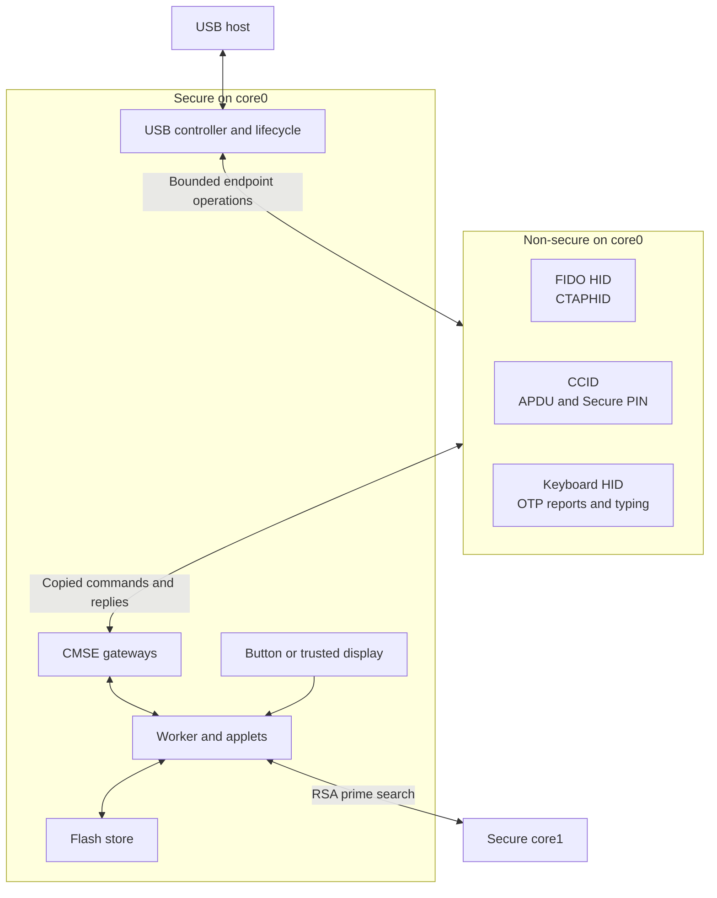

# Architecture

RS-Key is a composite USB authenticator for the RP2350. The Non-secure
firmware handles USB classes and framing. The Secure firmware owns the
USB controller, runs the applets and decides whether a command may use a
credential. See the [threat model](threat-model.md) for security assumptions.

## The big picture

The three interfaces are FIDO HID (usage page `0xF1D0`), CCID (USB class
`0x0B`) and a HID keyboard. The keyboard interface types OTP values and
carries OTP HID feature reports. The interface mask in `EF_PHY` can disable
interfaces at boot.

`rsk-usb` reassembles CTAPHID messages and handles CCID framing. The
Secure worker dispatches the copied request through `rsk-device`, which
applies applet availability and routing policy. USB interface availability
and applet availability are separate settings. For example, CCID can
carry FIDO commands as well as OpenPGP, PIV, OATH and management APDUs.

### RSA on core1

Core0 runs the worker and USB. During RSA key generation it also tests
prime candidates. Core1 uses a per-job HMAC-DRBG, seeded by core0, and
returns primes through a Secure mailbox. Between jobs it waits in
`WFE`. The Fermat-filter modular exponentiation runs from SRAM to keep
both cores from competing for XIP instruction fetches on that path.

Once core0 has enough primes, it asks core1 to cancel. Core1 can stop at
a Lucas-test progress boundary and scrubs its candidate and sieve. The
result need not wait for that cleanup. A core1 that stops responding
is marked faulted and subsequent key generation stays on core0.
`core1-stats` exposes diagnostic counters in a test build.

There are two flash handshakes. Quad-read mode changes use a dedicated
interrupt-masked SRAM park. The firmware changes the QMI mode before
core1 starts or after it acknowledges that park, skips the change while
core1 is busy, and restores the prior mode if the probe fails.
For erase and program, embassy-rp uses `pause_core1()` and an SRAM
flash routine. Its FIFO handler and pause loop are in flash-backed
`.text`. `PLAT-XIP-001` tracks whether the parked loop stays in cache
throughout an erase.

## TrustZone

Every authenticator build uses Secure (S) and Non-secure (NS) execution on
core0. The worker runs on the Secure `SWI_IRQ_0` executor. The NS USB
executor uses the higher-priority `SWI_IRQ_1` so it can send keepalives
during Secure work. Core1 runs Secure code.

The boundary assumes arbitrary privileged NS code. That code can forge
transport state, call the gateways directly, stop serving USB or read
plaintext sent through it. A plaintext host PIN carried in an APDU is
visible there. A PIN entered on the device screen is collected and
checked in S. The applets decide which PIN, management authentication,
presence or other policy a command requires.

The boot ROM, hardware access controls and Secure code are part of the
trusted computing base. That includes the Secure USB driver and lifecycle
observer, gateway validation, applet parsers, crypto, storage and board
I/O. See [Platform assumptions](platform-assumptions.md) for dependencies
and [Testing](testing.md#trustzone-on-hardware) for verification scope.

### Resource ownership

| Resource | Secure owner | Non-secure access |
|---|---|---|
| Memory | S flash, SRAM and stacks. The Secure gateway veneers occupy the NS-callable (NSC) region. | Its own code, vector table, stack and SRAM. Calls to S enter through NSC veneers. |
| Core1 and cross-core controls | RSA engine, DRBG, mailbox, stack, launch and flash-pause handshakes | No access to the RSA engine or its reserved SIO resources |
| USB hardware | USBCTRL, DPRAM, physical endpoints, interrupt and bus lifecycle | Bounded endpoint operations and copies of packets and events |
| USB classes | S supplies the boot identity and interface mask, and checks endpoint allocation. | USB descriptors, CTAPHID and CCID framing, keepalives, OTP HID and keyboard reports |
| Timers | TIMER0, tick generation, clocks and reset controls | TIMER1 for the NS executor |
| Flash and keys | KV store, QMI and XIP controls, OTP and TRNG | Applet operations through the worker |
| Board I/O | Presence button, panel and touch, LED and their GPIO, PWM, PIO, SPI and I²C | Status and cancellation through the gateways |
| Access policy | SAU, MPU setup, ACCESSCTRL, DMA channel security, interrupt routing and watchdog | Only the resources granted to NS |

Before starting NS, S sets up the Security Attribution Unit (SAU),
memory protection and interrupt routing. Peripheral permissions are
written and read back. DMA channels are locked to Secure privileged
access, and NS receives no raw DMA or GPIO controls. The linker reserves
448 KiB of main SRAM for S and 64 KiB for NS. Secure scratch SRAM has a
separate region for code that must run off flash.

### Gateway and data contract

`rsk_usb::worker_abi` defines the worker exchange. The gateway checks the
whole NS buffer span, and the worker checks the command kind and length
before copying it into Secure memory. S parses and authorizes the copied
command. It retains no pointer into the caller's memory.

The worker issues a ticket for the copied job. Channel IDs, CCID sequence
numbers and job tickets route traffic. Authorization remains applet
state in S. Polling a valid ticket can copy a reply back to NS. The USB
gateway separately checks endpoint allocation and the current bus epoch
before it arms a physical transfer. S observes EP0 setup packets before
the NS USB stack handles them.

### USB reset and authorization

The Secure USB controller path observes reset, suspend and loss of
configuration. A detected power removal also revokes the session. S
checks lifecycle events at the boundaries where it admits or dispatches
work and publishes a reply. On revocation it advances the bus epoch,
invalidates old transfers and revokes the worker's transport session.
NS cannot mask the physical interrupt or clear the hardware reset latch.

A queued command can be discarded. A synchronous command already in
progress can finish and commit changes, but its old reply cannot be
published after revocation. Replies already copied to NS remain visible
there. Before admitting another command the worker
clears the affected transport buffers, PIN/UV tokens, applet authentication
and presence state. Resume can restore traffic, but the host must
authenticate again. Persistent keys, configuration and retry counters
survive a USB reset. CCID card reset has its own narrower scope.

A fatal fault handled in S disconnects USB and clears endpoint buffers
before halting. That path uses Secure USB registers directly so it can
run even if the fault interrupted the driver.

### TrustZone build and boot

`scripts/build.sh` links S to create the CMSE import library, links NS
against that library and its generated memory map, then embeds the NS
binary in the final S link. The script compares the two import libraries
so the gateway addresses agree. The first link halts at startup because
it contains no NS payload. The builder adds the partition table before
converting the final ELF to UF2.

`nix build .#firmware` produces the combined image under `result/`.
The local builder defaults to `target/trustzone/combined.elf` and
`combined.uf2`. The combined ELF is the input to
[production signing](production.md). Updates to a provisioned key must
preserve its flash geometry and KV layout. See [Build options](build.md)
for board and feature settings.

TrustZone controls access after boot. Enforced Secure Boot authenticates
the image before execution. OTP provisioning supplies the fused storage
roots. `rsk-wipe` is a separate SRAM-resident recovery utility.

## Boot sequence

1. The boot ROM selects the image and verifies it when Secure Boot is
   enforced. Secure startup copies the scratch code and starts the
   Secure executor.
2. Secure boot code initializes the board, reads the chip ID, validates
   the OTP provisioning state and sets the Non-secure software lock for
   page 58. It seeds the DRBG from the TRNG and uses it to draw a storage
   epoch for initialization.
3. A Secure storage task binds the root-key source and mounts the KV
   backend. The boot task scans file records and reads `EF_PHY` to
   choose the USB identity and interface mask. If storage is unavailable,
   it selects CCID only for recovery.
4. Secure code runs the applicable provisioning, seal migration and
   at-rest scrub passes. Automatic page-58 sealing waits for the
   remaining pre-OTP records and scrub to clear. Some legacy records need
   a successful PIN entry before they can migrate. A newly closed latch
   requests a scrubbed reboot.
5. S stores the selected USB identity and brings up board I/O and core1.
   The worker task constructs the applet handlers in their static cells.
   If a sealing reboot was requested, the worker scrubs and reboots here.
   Otherwise it prepares the Secure USB front-end.
6. S installs the TrustZone policy and enters the NS reset vector. NS
   reads the prepared identity and builds the USB classes. Building the
   USB device calls the Secure driver to assert the pull-up. NS then
   starts the tasks that answer the host.

The backend, applet handlers and large transport buffers live in static
owners. Boards with at most 2 MiB of flash construct the backend at
runtime to keep its zero-filled arrays out of the image. NS exchanges
borrow a shared reply buffer and clear it on release.

The firmware rejects entropy draws containing an all-zero 192-bit TRNG
block. Boot halts before USB after three failed draws and wipes the
failed seed and dead stack. The DRBG attempts a reseed after 64 KiB of
output. If the draw fails, it keeps using the checked DRBG state until
the worker runs a scrubbed reboot.

## Crates

`firmware` and `firmware-ns` are the two halves of the authenticator.
`rsk-wipe` builds separately. The applet and supporting crates have host
tests. The diagram and its dependency counts are checked against the
workspace manifests.

| Crate | Role |
|---|---|
| `firmware` | Secure board startup, USB controller, worker, OTP, storage, presence and RSA core1 |
| `firmware-ns` | USB descriptors and classes, CTAPHID and CCID framing, OTP HID, keyboard and TIMER1 |
| `rsk-wipe` | SRAM-resident flash erase utility that reboots to BOOTSEL |
| `rsk-device` | Applet composition, dispatch and capability gates, transport sessions, presence arbitration and reboot requests |
| `rsk-sdk` | APDU and BER-TLV codecs, applet dispatch, status words, RNG and presence traits |
| `rsk-usb` | CTAPHID and CCID transport state, USB identity and the shared worker ABI |
| `rsk-fido` | CTAP2 and U2F, credential and PIN/UV policy, extensions, attestation and seed management |
| `rsk-openpgp` | OpenPGP card data, PIN state, key lifecycle, crypto and attestation |
| `rsk-piv` | PIV slot policies, PIN and management authentication, key and certificate lifecycle and private operations |
| `rsk-oath` | YKOATH TOTP and HOTP credentials, access codes and touch policy |
| `rsk-otp` | Four Yubico OTP slots, CCID commands, OTP HID reports and keyboard tickets |
| `rsk-mgmt` | YubiKey management commands, including reading and writing the device configuration |
| `rsk-rescue` | Recovery and provisioning commands for board config, flash, attestation, reboot and OTP sealing |
| `rsk-vendor` | Vendor AID commands for LED settings, reboot and diagnostics |
| `rsk-fs` | File IDs, metadata, applet storage APIs and record lifecycle over the `Storage` trait |
| `rsk-store` | NOR flash backend, authenticated directory and counter banks, legacy import, fault recovery and compaction |
| `rsk-devconf` | `EF_DEV_CONF` codec, application capability masks, config lock and updates |
| `rsk-phy` | `EF_PHY` codec and boot policy for USB identity, interface mask and board settings |
| `rsk-led` | `EF_LED_CONF` codec for status LED behavior |
| `rsk-crypto` | Hashes, MACs, KDFs, symmetric crypto, DRBG and post-quantum primitives |
| `rsk-ec` | EC and Edwards key formats, public-key derivation, signing and key agreement |
| `rsk-rsa` | RSA key generation and sealed CRT key layout, blinded and fault-checked private operations, with embedded C/assembly arithmetic and a Rust host path |
| `rsk-mldsa` | Stack-bounded ML-DSA for the three parameter sets |
| `rsk-sha256` | SHA-256 compression and digest implementation |
| `rsk-sha512` | Compact SHA-512 and SHA-384 implementations for XIP |
| `rsk-secret` | `Secret` and `WipeGuard` for wiping key material |
| `rsk-x509` | DER and certificate construction shared by the card applets |
| `rsk-bench` | Cold sample, median and median absolute deviation for on-device benchmarks |
| `rsk-bip39` | BIP-39 mnemonic encoding for the display's recovery screen |
| `rsk-slip39` | SLIP-39 share encoding for the display's recovery screen |
| `rsk-ui` | Display layout, prompt text and sanitization, retained scenes and rasterization |
| `rsk-display` | Trusted-display flows for confirmation, PIN entry and local applet screens over panel and touch traits |

## Flash layout

The builder generates the memory map from the board's flash geometry.
The default 4 MiB Waveshare RP2350-One layout is below. End addresses
are exclusive.

| Region | Start | End | Contents |
|---|---|---|---|
| Secure image region | `0x10000000` | `0x1026F000` | Secure firmware and boot blocks |
| NSC | `0x1026F000` | `0x10270000` | CMSE gateway veneers |
| NS image | `0x10270000` | `0x10280000` | Embedded NS firmware |
| KVMAIN | `0x10280000` | `0x103E0000` | 1408 KiB main payload store |
| KVCNT | `0x103E0000` | `0x10400000` | 128 KiB for authenticated directories and counter banks |

The last 64 KiB of the firmware region holds the NS image, with a
4 KiB NSC window immediately below it. A 16 MiB part reserves its final
4 KiB sector for the RP2350-E10 workaround. The storage regions end below
that sector.

The partition table groups KVMAIN and KVCNT into one `RS-Key Store`
partition. The TrustZone builder reads `__kvmain_start` and `__kvcnt_end` from
the combined ELF. The table grants Secure read and write and denies
both to NS and BOOTSEL. The firmware region remains available for an
update. With Secure Boot enforced, the signature also covers the table.
See [Flash snapshot rollback](threat-model.md#flash-snapshot-rollback-the-pin-counter-reset)
for the limits of this fence.

Files use 16-bit IDs. The applets' reset paths select the records they
own. Shared records have explicit reset rules. The payload ring uses
`sequential-storage`, while the authenticated directories and counter
banks use their own journal formats.

### Keys and credential IDs

The FIDO seed and enterprise attestation key use ChaCha20-Poly1305 at
rest. AES-CBC seed records are a legacy format that the loader can
migrate. PIV private keys use AES-256-GCM. OpenPGP private keys use a
separate PIN-wrapped data-encryption key. The pre-OTP device root derives
from the chip identity. Provisioning the OTP MKEK adds a fused secret
to the root derivation for the applicable seals. Boot and PIN-verify
paths migrate eligible old records, and the scrub reclaims the
superseded copies.

A current non-resident FIDO credential ID is a ChaCha20-Poly1305 box.
The relying party stores it. The device seed derives the encryption
key and the RP ID hash is associated data. Its format is a 12-byte nonce,
encrypted CBOR, a 16-byte Poly1305 tag and a 16-byte silent tag. Current
boxes have no cleartext prefix. The loader also accepts the legacy
prefixed format. The advertised `maxCredentialIdLength` of 748 bytes
includes that four-byte overhead.

A resident credential returns a separate 42-byte lookup ID. The full
box stays on the device. New v4 IDs are derived from the randomized box
without the old fixed header, then stored and returned verbatim.
Current resident credentials and legacy v2/v3 credentials derive keys
from that stable ID, so changing user metadata can reseal the box
without changing the credential's key. Legacy v1 credentials retain
their original derivation.

## Capacity — why the flash is mostly empty

The standard KV layout totals 1.5 MiB. Larger boards with the standard
KV settings use the extra space for the firmware region. The supported
2 MiB layout reduces KVMAIN to 896 KiB. The logical limits are
`MAX_RESIDENT_CREDENTIALS` (256 passkeys), `MAX_DYNAMIC_FILES` (1280
files across the applets) and `OATH_SLOTS` (255 OATH credentials).
`MAX_VALUE_BYTES` is 4078 bytes. File size, shared slots and available
flash can limit a workload before it reaches an applet's slot count.

### Storage authority and recovery

KVMAIN holds payloads. KVCNT holds two 44 KiB main-directory journals
and two 20 KiB counter banks. The authenticated directory binds the live
file set and the partition, epoch, generation, length and content of
each value. A missing expected payload or a failed authentication
returns a storage error. The directory can also authenticate absence.

A main-store mutation reserves space, records an intent, verifies the
candidate and publishes the new directory to both journals. On mount,
recovery can finish the candidate or retire its reservation before
garbage collection. Counter updates publish and verify both copies.
The routed PIN retry and HOTP values are bound to their owner's
publication generation. Replacing or deleting the owner invalidates
that binding.

A warm read checks the current root and authenticates the requested
payload against the mounted authority. Caches hold metadata and
authentication tags. Mutation checks fresh fingerprints of physical
journals and erased tails before it reuses cached positions. The
board's SHA-256 peripheral can hash public journal bytes, and bulk
flash reads use the Secure core0 XIP FIFO. Root-key HMACs run in
software. Invalidating a cache hint leaves the live authenticated
generation floor in place. A full flash snapshot replay after cold
boot remains subject to the [rollback limitation](threat-model.md#flash-snapshot-rollback-the-pin-counter-reset).

Boot initializes blank media or imports a readable legacy store.
Import verifies its backups before it erases the old counter
partition and can resume after interruption. Read faults, damaged
authority and malformed legacy layouts take the CCID rescue path.
See [storage initialization and upgrades](guides/cli.md#storage-initialization-and-upgrades)
for attended recovery.

## Device identity

The default USB VID:PID is `0x1209:0xF1D2`, with manufacturer
`RS-Key` and product `RS-Key Security Key`. The optional `VIDPID=Yubikey5`
preset uses `0x1050:0x0407` for tools that recognize the Yubico reader
name. See [Build options](build.md) for identity overrides.

A valid `EF_PHY` can override VID/PID, manufacturer, product and the
interface mask. S resolves the effective identity before NS builds its
descriptors. The effective VID also selects the default reader strings
and the CCID ATR variant. The USB serial descriptor is `rs-key-0001`.
Chip-derived identifiers used by the applets are separate from that
descriptor. `FW_VERSION` sets the reported applet firmware version.
USB `bcdDevice` is the build counter described in [Versions](versioning.md).

## User presence

Headless boards use BOOTSEL or a configured `PRESENCE_PIN`. A display
build uses the touchscreen as its presence source. Both go through
`rsk_sdk::UserPresence`, shared by the Secure applets.

`request` serves a touch policy such as OpenPGP UIF, a PIV slot or an
OATH credential. `request_ceremony` handles host ceremonies such as
WebAuthn registration and assertion and the gate before PIN-pad entry.
The display shows an operation prompt, with a save action for
registration and a hold when the ceremony requires it. A scoped
CTAPHID cancel can end the waiting FIDO ceremony without approving
it. Idle button clicks can select OTP keyboard slots. A press used
for a ceremony is consumed before the idle watcher can count it.

The trusted display can collect PINs in Secure code. This is user
verification, separate from approving a request. A host-entered PIN
follows the protocol's own transport path. The `no-touch` test feature
can auto-confirm button requests. See [Trusted display](guides/display.md)
for the available flows.

## Without a board

`tools/emu` offers two backends. The applet backend runs the shared
applets, dispatch and store on the host, with its own transport and
board hooks. The `--image` backend boots the combined firmware ELF
through the RP2350 boot ROM on picoem. It executes the Secure and
Non-secure firmware against modeled USB, flash, OTP and other
peripherals. A display build can also use the modeled panel and touch
controller in the image backend.

Both backends can serve CTAPHID and CCID over TCP or expose a USB
device through USB/IP on Linux. See [Testing](testing.md#without-a-board--the-emulator)
for which cases each backend can exercise.

## Provenance

RS-Key reimplements applet behavior and protocol surfaces from
[pico-keys](https://github.com/polhenarejos). The firmware uses Embassy
for the runtime and USB stack, RustCrypto and in-tree crypto crates,
and `minicbor` for CBOR. Embedded RSA arithmetic and CMSE entry code
also use C and ARM assembly. See
[NOTICE](https://github.com/TheMaxMur/RS-Key/blob/main/NOTICE) for
upstream components and licenses.
