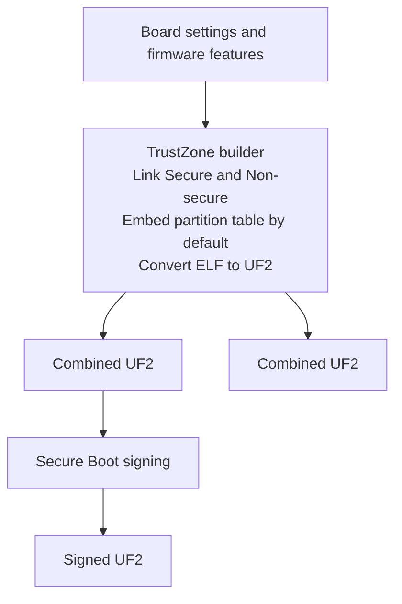
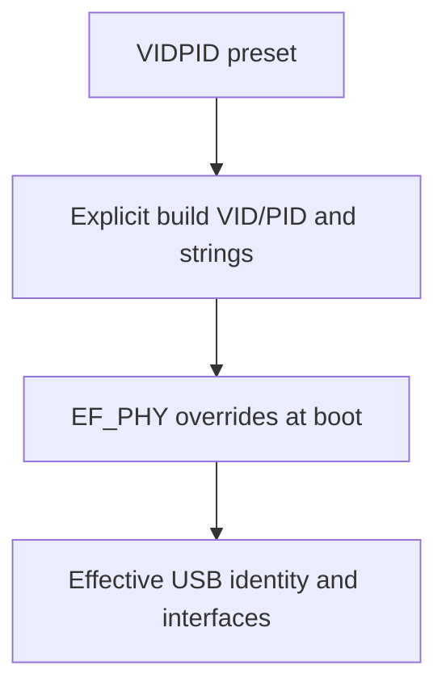

# Build options

Every authenticator build combines Secure and Non-secure firmware for the
RP2350. The default output is an unsigned ELF and UF2 with the storage
partition table. For a Secure Boot device, follow the
[production signing procedure](production.md#2b-sign-and-prove-a-signed-image-boots-before-any-fuse).

## Local build

From the repository root:

```sh
nix develop -c bash scripts/build.sh
```

The builder links Secure first to export its CMSE gateways. It links
Non-secure against that import library, then embeds the Non-secure payload
in the final Secure link. It checks that the gateways stayed at the same
addresses, embeds the partition table and converts the resulting ELF to UF2.
Bare Cargo builds require the builder's link-stage inputs.



### Environment and Cargo arguments

Use `--features a,b`, `--features=a,b`, `-F a,b`, `-Fa,b` or
`FEATURES=a,b`. These forms compose, including repeated flags and
whitespace-separated feature lists. Both Secure links use the same features.
The builder resolves Cargo's dependency graph and forwards the effective
`strict-config` policy to Non-secure. `--no-default-features` applies to
both worlds.

| Argument | Effect |
|---|---|
| `--config KEY=VALUE` or `--config PATH` | Merge Cargo configuration. Options can repeat, and file paths are relative to the calling directory. |
| `--jobs N`, `-j N`, `--offline`, `--frozen`, `--locked` | Cargo concurrency and dependency resolution. The builder always passes `--locked`. |
| `--verbose`, `-v`, `-vv`, `--quiet`, `-q`, `--color`, `--message-format`, `--timings`, `--keep-going`, `--future-incompat-report` | Cargo output and build controls |
| `--release`, `-r` | Accepted for compatibility. The builder always uses the release profile. |
| `--target-dir DIR` | Set the output directory as described below |
| `--no-partition-table` | Build both artifacts without the [BOOTSEL storage fence](#the-partition-table) |
| `--help`, `-h` | Print usage |

Long options with a value also accept `--option=value`. The short
`-jN` form works for the job count.

The target is `thumbv8m.main-none-eabihf`. The builder rejects package,
manifest, target and profile selectors, `--all-features` and unknown options.

Exported values reach Cargo without shell expansion. The builder sets a
separate Cargo target directory for each world and owns its link-stage
variables. `RSK_TZ_CARGO_CONFIG` can supply one extra `--config` value.
The remaining `RSK_TZ_*` controls outside the output settings below
are used by the builder or the [image test harness](testing.md#the-image-itself----image).

Cargo's `CARGO_ENCODED_RUSTFLAGS` and `RUSTFLAGS` override the flags from
`.cargo/config.toml`, including required linker flags. To add target flags,
merge the target configuration instead.

```sh
nix develop -c env BOARD=waveshare-one USB_PRODUCT="RS-Key local build" \
  FEATURES=strong-pin bash scripts/build.sh -F strict-config --offline --jobs 4

nix develop -c bash scripts/build.sh \
  --config 'target.thumbv8m.main-none-eabihf.rustflags=["--cfg=local_build"]'
```

### Output directories

The builder writes `combined.elf` and `combined.uf2` to the first
applicable directory in this list.

1. `DIR/trustzone` if you pass `--target-dir DIR`.
2. `RSK_TZ_OUT` if set.
3. `CARGO_TARGET_DIR/trustzone` if set.
4. `target/trustzone` in the repository.

Paths supplied by the caller are resolved from the calling directory.
Cargo artifacts go under `secure/` and `nonsecure/` within the output.
Use a separate output directory for each concurrent build or experiment.

## Cargo features

Physical presence is enabled by default. The features below are opt-in.
Several features are available as [Nix presets](#nix-build-hermetic-no-dev-shell).

| Feature | Effect |
|---|---|
| `advertise-pqc` | Advertises ML-DSA-87, -65 and -44 in FIDO getInfo. makeCredential can negotiate the algorithms with the flag off. |
| `strong-pin` | Raises the FIDO PIN minimum from four to six code points and rejects common patterns. Also applies to the FIDO PIN policy on the display. |
| `fips-profile` | Applies the strong PIN policy, removes FIDO secp256k1, refuses seed export, and restricts PIV management keys and algorithms. See [FIPS-style profile](guides/fips.md) for scope. |
| `always-uv` | Compiles with CTAP `alwaysUv` enabled by default. A runtime override survives reboot, and authenticator reset restores the compiled default. With no configured PIN, CTAP2 requests that need verification return `PUAT_REQUIRED`. U2F is unavailable while `alwaysUv` is active unless configured built-in UV can protect it. |
| `strict-up` | Requests presence even for a silent `up:false` getAssertion probe. The reply still leaves the UP flag clear for that probe. An allowList login can require a press for the probe and another for the assertion. |
| `strict-config` | Requires authorization for configuration writes on the gated paths and disables ungated CTAPHID and OTP HID config writes. With the flag off, those writes are available for YubiKey interoperability. |
| `largeblob-ext` | Selects the CTAP 2.3 per-credential `largeBlob` extension. It replaces `largeBlobKey` and `authenticatorLargeBlobs` and stores up to 4046 bytes per discoverable credential. Client support depends on the extension the client speaks. |
| `display` | Enables the trusted display, on-device PIN entry and local screens. Use a compatible display board and `LED_KIND=none`. See [Trusted display](guides/display.md). |
| `preview-sign` | Enables the experimental `previewSign` extension. |
| `no-touch` | Auto-confirms button-based presence for automated tests. Use a presence-enabled build for deployment. |
| `fido-conformance` | Enables the conformance profile, including `strict-up`, and suppresses EdDSA advertisement. |
| `ea-conformance-rpid` | Adds the conformance RP ID to the vendor-facilitated enterprise attestation list and enables `fido-conformance`. |
| `bench`, `keygen-bench`, `core1-stats` | Test-only vendor commands for primitive timing, keygen timing, stack diagnostics or core1 counters. |

## Environment variables

`BOARD` loads defaults from a named TOML file under `firmware/boards/`.
An explicitly exported knob wins over a board value. A board selects
hardware settings. Enable the display feature separately. With no board
selected, the build uses the defaults below.

| Variable | Default | Accepted values and effect |
|---|---|---|
| `BOARD` | unset | `abrobot-4m`, `abrobot-16m`, `waveshare-one`, `waveshare-touch-lcd`, `tenstar-usb`, `seeed-xiao`. Use the file stem, without `.toml`. |
| `VIDPID` | `RSKey` | USB identity preset. `RSKey` is `0x1209:0xF1D2`. Other presets are `Pico`, `Dev`, `Yubikey5`, `YubikeyNeo`, `YubiHSM`, `NitroHSM`, `NitroFIDO2`, `NitroStart`, `NitroPro`, `Nitro3`, `Gnuk` and `GnuPG`. Use vendor presets for local interop. |
| `USB_VID`, `USB_PID` | from preset | 16-bit IDs in decimal or `0xHHHH` form. Either half can override the preset independently. |
| `USB_MANUFACTURER`, `USB_PRODUCT` | `RS-Key`, `RS-Key Security Key` for the default identity | Descriptor strings. An effective Yubico VID uses the built-in Yubico reader strings unless `EF_PHY` supplies a string override. |
| `FW_VERSION` | `5.8.0` | `X`, `X.Y` or `X.Y.Z`, with components from 0 to 255. Sets the reported applet firmware version. |
| `XOSC_DELAY_MULT` | `128` | `1..=1024`. Crystal oscillator startup delay multiplier. |
| `FLASH_SIZE` | `4M` | Physical flash size, in bytes, hex, or with a `K` or `M` suffix. Must be 4 KiB aligned and at most 16 MiB. |
| `KVMAIN` | `1408K` | Main-store capacity. Same size syntax as `FLASH_SIZE`, 4 KiB aligned, at least 128 KiB. Preserve the layout when updating a provisioned device. |
| `LED_KIND` | `ws2812` | `ws2812`, `gpio`, `pimoroni` or `none`. Sets the boot default. `none` omits the status LED support and is required by the display build. |
| `LED_PIN` | `16` | GPIO 0–29 for the WS2812 data line or GPIO status LED. Pimoroni PWM uses its fixed pins. |
| `LED_ORDER` | `rgb` | `rgb` or `grb` wire order for addressable LEDs |
| `LED_POWER_PIN` | `none` | `none` or GPIO 0–29, held high to power a gated LED rail. Use a pin distinct from the status LED and presence input. |
| `MAX_LEDS` | `1` | `1..=64`. Compiled addressable LED capacity. The runtime LED count must fit it. |
| `USR_LED_PIN` | `none` | `none` or GPIO 0–29. Holds a separate onboard LED off. Must avoid the status LED, LED power and presence pins. Display builds require it unset. |
| `USR_LED_ACTIVE_HIGH` | `0` | `1` for an active-high user LED. `0` holds an active-low LED off. |
| `PRESENCE_PIN` | `bootsel` | `bootsel` or GPIO 0–29. Display builds use touchscreen presence and reject a GPIO presence pin. |
| `PRESENCE_ACTIVE_HIGH` | `0` | `1` for an active-high GPIO presence button. `0` selects an active-low button with a pull-up. |
| `WAKE_PIN` | `25` | Display wake button. Use `none` for touch-only wake or a free GPIO 0–29. |
| `WAKE_ACTIVE_HIGH` | `0` | `1` for an active-high wake button. `0` selects active-low. |
| `FAKE_MKEK`, `FAKE_DEVK` | unset | Test-only OTP substitutes, each 64 hex digits. They are embedded in the binary. Use disposable test storage. |

Boolean GPIO settings also accept `true/false`, `yes/no` and `on/off`.
For display boards, the `PK_DISPLAY_*` overrides below take precedence
over the corresponding `[display]` TOML settings.

| Variable | Fallback | Setting |
|---|---|---|
| `PK_DISPLAY_SPI_FREQ_HZ` | `80000000` | Panel PIO serial clock. The firmware requires half its fixed 160 MHz system clock. |
| `PK_DISPLAY_CS`, `PK_DISPLAY_DC`, `PK_DISPLAY_RST` | `13`, `14`, `15` | Panel control GPIOs |
| `PK_DISPLAY_BL_PIN`, `PK_DISPLAY_BL_PWM_SLICE`, `PK_DISPLAY_BL_PWM_CHANNEL` | `16`, `0`, `0` | Backlight GPIO, PWM slice and channel. Use a supported tuple from the board wiring. |
| `PK_DISPLAY_TP_RST`, `PK_DISPLAY_I2C_FREQ_HZ` | `17`, `400000` | Touch controller reset GPIO and I²C clock |
| `PK_DISPLAY_INVERT_COLORS`, `PK_DISPLAY_COLOR_ORDER` | `1`, `0` | Panel color inversion and RGB/BGR selection. `1` selects inversion or BGR, respectively. |

## Flash size and the memory map

The linker places the firmware region below KVMAIN and the fixed 128 KiB
KVCNT. The builder requires at least 1 MiB for firmware. The last 64 KiB
of that region holds Non-secure, with the 4 KiB CMSE gateway window
immediately below it. See the [Architecture flash map](architecture.md#flash-layout)
for the addresses on the 4 MiB board.

| Geometry | Firmware region | KVMAIN | KVCNT |
|---|---:|---:|---:|
| `FLASH_SIZE=2M KVMAIN=896K` | 1024 KiB | 896 KiB | 128 KiB |
| `FLASH_SIZE=4M KVMAIN=1408K` | 2560 KiB | 1408 KiB | 128 KiB |
| `FLASH_SIZE=16M KVMAIN=1408K` | 14844 KiB | 1408 KiB | 128 KiB |

At 16 MiB, the linker leaves the final 4 KiB sector unpartitioned for
the RP2350-E10 workaround at `0x10FFFF00`. Smaller devices end below
that sector. The 2 MiB profile constructs its storage backend at
runtime to save space in the ELF.

`check.sh` checks the combined image's flash budget of 1024 KiB, which
counts the embedded NS payload once. Its Secure stack floors are
120 KiB for the ordinary image and 116 KiB for display. Both require
20 KiB of Non-secure stack. The embedded linker uses `flip-link`, with
`rust-lld` available in the development shell.

## The partition table

The TrustZone builder embeds the table in the final ELF before UF2
conversion. It reads `__kvmain_start` and `__kvcnt_end` from the linked
image. The firmware partition permits BOOTSEL updates. The store
partition allows Secure reads and writes and denies Non-secure and
BOOTSEL access. The gate compares the resulting table with the same
linker symbols.

Secure Boot authenticates the table as part of the signed image. See
[Flash snapshot rollback](threat-model.md#flash-snapshot-rollback-the-pin-counter-reset)
for the fence's scope.

For a diagnostic build that omits the table from both artifacts:

```sh
nix develop -c bash scripts/build.sh --no-partition-table --target-dir /tmp/rsk-unpartitioned
```

The flag preserves the Secure/Non-secure memory layout and omits the
BOOTSEL storage fence. The named Nix packages and release workflow use
the default partitioned build.

## Examples

```sh
# Default 4 MiB image with physical presence
nix develop -c bash scripts/build.sh

# 2 MiB Seeed XIAO RP2350
nix develop -c env BOARD=seeed-xiao bash scripts/build.sh

# Waveshare touch display
nix develop -c env BOARD=waveshare-touch-lcd bash scripts/build.sh --features display

# YubiKey-compatible identity for local interop
nix develop -c env VIDPID=Yubikey5 bash scripts/build.sh

# Automated tests
nix develop -c bash scripts/build.sh --features no-touch

# Require authorization for gated configuration writes
nix develop -c bash scripts/build.sh --features strict-config
```

Inspect an ELF or UF2 without flashing with `picotool info -a`. The
default build writes `target/trustzone/combined.elf` and
`target/trustzone/combined.uf2`.

## `nix build` (hermetic, no dev shell)

```sh
nix build .#firmware
# result/firmware.elf and result/firmware.uf2
```

Nix pins the toolchain and dependencies and uses the TrustZone builder.
The derivation remaps build and toolchain paths so they do not enter
the artifact under their local names. The release workflow rebuilds
each published flavor and compares its UF2 bytes. See
[Supply chain](supply-chain.md) for reproducibility and verification.

| Package suffix after `firmware` | Settings |
|---|---|
| none, `-trustzone` | Default TrustZone configuration. The filename uses the package name. |
| `-2mb`, `-16mb` | 2 MiB with `KVMAIN=896K`, or 16 MiB with the default KV size |
| `-display` | `display`, `FLASH_SIZE=16M`, `LED_KIND=none` |
| `-pico` | `VIDPID=Pico` |
| `-pqc` | `advertise-pqc` |
| `-fips`, `-strong-pin`, `-always-uv`, `-strict-up` | Corresponding feature, also available with an added `-pqc` suffix |
| `-strict-config` | `strict-config` |
| `-no-touch`, `-no-touch-pqc`, `-no-touch-fips`, `-no-touch-fips-pqc` | Test images with the named feature combinations |

The packages emit unsigned ELF and UF2 files. To sign a Secure Boot
update, seal the partitioned ELF and convert the signed ELF to UF2.
See [Production setup](production.md#2b-sign-and-prove-a-signed-image-boots-before-any-fuse)
and [Anti-rollback](anti-rollback.md) for the required image metadata.

## `nix run` — host tools without the dev shell

```sh
nix run .#rsk -- --help
nix run .#rsk-tui
nix run .#flash -- --help
```

`nix run .#flash` signs the default Nix ELF or a supplied partitioned
combined ELF and flashes it. It expects a board provisioned for the
matching signing key. `RS_KEY_SECRETS` selects the directory containing
`secure_boot_key.pem` and `otp_secureboot.json` (default
`~/.rs-key-secrets`). `RSK_ROLLBACK` selects the rollback version
(default `1`). It prompts before flashing. `-y` skips the prompt.

## Runtime overrides (phy record)

`EF_PHY` stores board settings in flash. At boot its valid VID/PID and
USB strings override the build defaults, and its interface mask selects
which USB classes to expose. It can also set the presence timeout and
supported LED settings. Use [the CLI](guides/cli.md) for runtime settings.



An ordinary firmware update preserves `EF_PHY` with the rest of the
store. To change a stored override, update the record through a
reachable interface. If storage cannot mount, the boot path selects
CCID for recovery.

## Notes

- USB `bcdDevice`, the applet firmware version (`FW_VERSION`) and the
  Secure Boot rollback version are separate values. See [Versions](versioning.md).
- The effective Yubico VID uses Yubico-style reader strings and ATR by
  default. The `Yubikey5` preset is intended for clients such as
  `ykman` that use the Yubico reader name.
- The TUI has its own development shell, `nix develop .#tui`.

## TrustZone boundary

[Architecture](architecture.md#trustzone) describes the resource split,
USB lifecycle and gateway checks. Both development and production
builds use that boundary.

### Reproducible configuration and environment overrides

For a custom Nix image, call `mkFirmware`. It accepts `features` as a
string, `cargoFlags` as a list of builder arguments, and `env` for the
firmware knobs listed above. Unknown `env` keys are rejected. Named
arguments also exist for `board`, `vidpid`, `usbVid`, `usbPid`,
`fwVersion`, `xoscDelayMult`, `flashSize`, `kvmain`, `ledPin`,
`ledKind`, `presencePin`, `fakeMkek` and `fakeDevk`.

```sh
nix build --impure --expr \
  '(builtins.getFlake (toString ./.)).lib.${builtins.currentSystem}.mkFirmware {
     name = "fw";
     board = "waveshare-one";
     features = "strong-pin,strict-config";
     env = { USB_PRODUCT = "RS-Key local build"; };
   }'
```

Named arguments override `env`, which overrides ambient values read
during impure evaluation. `FEATURES` is the ambient fallback for
`features`. A pure build ignores ambient knobs. For a local impure build
you can use `BOARD=waveshare-one FEATURES=strong-pin nix build --impure .#firmware`.
Signing keys and the builder's internal TrustZone controls stay outside
the derivation.
