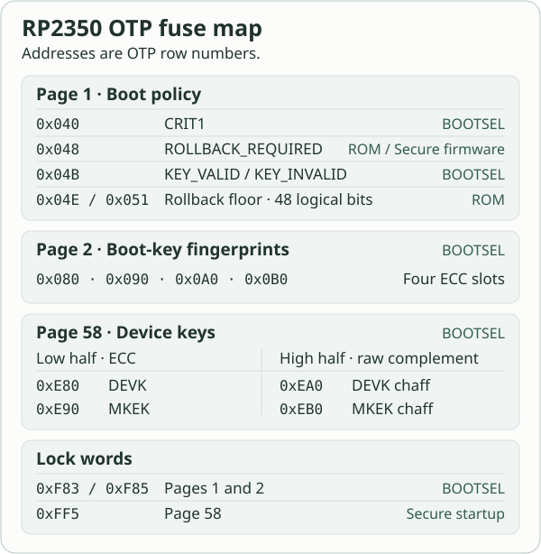

<!-- SPDX-License-Identifier: AGPL-3.0-only -->
<!-- Copyright (C) 2026 RS-Key contributors -->

# OTP fuses (RP2350)

RS-Key uses the RP2350's one-time-programmable (OTP) memory for its
device keys, Secure Boot policy and rollback floor. These are chip
fuses. One-time passwords are covered in the [OTP slot guide](guides/otp.md).
For provisioning commands and their order, see [Production](production.md).

## What OTP is

An OTP bit can be programmed from 0 to 1. It stays set through power
loss, reflashing and factory reset. Each chip has its own fuse state.

> ⚠️ Fuse writes are permanent. A wrong lock can make the keys unreadable,
> and a wrong boot policy can leave the board unable to load firmware.
> The provisioning CLI provides typed confirmations and `--dry-run` for
> host-initiated writes. A normal boot can also program fuses automatically
> during page-58 sealing or a rollback-floor advance.

## Layout: pages, rows, and reliability copies

The RP2350 has 64 OTP pages of 64 rows. Each raw row is 24 bits wide.
Page 58 starts at `58 × 0x40 = 0xE80`. Access locks apply to whole pages.

| Encoding | How to read it | Used here |
|---|---|---|
| RBIT-3 | Bitwise majority across three consecutive rows | `BOOT_FLAGS0/1`, rollback floor |
| RBIT-8 | A bit takes effect once three of its eight copies are set | `CRIT1`. The `harden` command verifies its hardening bits in all eight copies. |
| ECC | Each raw row has 16 data bits, six ECC bits and two polarity bits | Boot-key fingerprints, DEVK and MKEK |
| Page-lock word | Bitwise majority across three copies of the policy byte within one raw row | `PAGEn_LOCK1` |

See the [RP2350 datasheet, §§13.4–13.6](https://datasheets.raspberrypi.com/rp2350/rp2350-datasheet.pdf)
for the register layout and encodings.

## Who can write OTP, and when

- **The host through BOOTSEL.** The ROM's USB bootloader serves the
  `picotool` OTP commands subject to the page permissions. RS-Key uses this
  path for the initial device keys and Secure Boot provisioning.
- **Secure startup and the rescue applet.** Startup seals page 58 once the
  keys and the migrated storage are ready, including on boards with Secure
  Boot disabled. The explicit
  `rsk otp rollback-require` command asks the Secure rescue applet to set
  `ROLLBACK_REQUIRED`. A write requires Secure Boot to be enabled and
  confirmation on the device.
- **The boot ROM during normal Secure Boot.** A successful flash boot at a
  higher rollback version advances the OTP floor and sets
  `ROLLBACK_REQUIRED`. See [Anti-rollback](anti-rollback.md).

In a `LOCK1` policy byte, `LOCK_S` is bits 1:0, `LOCK_NS` is bits 3:2,
and `LOCK_BL` is bits 5:4. They represent Secure, Non-secure and bootloader
access. Each lock can progress from read-write to read-only to
inaccessible. `LOCK_BL` governs the bootloader path. It is separate from
the hardware's Secure and Non-secure access checks.

## What RS-Key burns

| Region | Rows | Contents | Writer |
|---|---|---|---|
| Boot policy, page 1 | `0x040–0x047` | `CRIT1`: Secure Boot enable, both debug disables, glitch detector enable and sensitivity | `rsk secure-boot harden` and `enable` |
| Boot policy, page 1 | `0x048–0x04A` | `BOOT_FLAGS0`: `ROLLBACK_REQUIRED` at bit 11 | Boot ROM, or `rsk otp rollback-require` through Secure firmware |
| Boot policy, page 1 | `0x04B–0x04D` | `BOOT_FLAGS1`: `KEY_VALID` and `KEY_INVALID` slot masks | `rsk secure-boot load-key`, `rotate`, `revoke`, `lock` |
| Rollback floor, page 1 | `0x04E–0x050`, `0x051–0x053` | `DEFAULT_BOOT_VERSION0/1`: 48 logical bits across two triplicated words | Boot ROM |
| Boot keys, page 2 | `0x080–0x0BF` | Four ECC-encoded SHA-256 fingerprints, 16 rows per slot. Starts: `0x080`, `0x090`, `0x0A0`, `0x0B0`. | `rsk secure-boot load-key` and `rotate` |
| Device keys, page 58 | `0xE80–0xEBF` | DEVK, MKEK and their paired chaff | `rsk otp burn` |
| Page-lock words | `0xF83`, `0xF85` | Page 1 and 2 `LOCK1`, `0x141414` | `rsk secure-boot lock` |
| Page-lock word | `0xFF5` | `PAGE58_LOCK1`, completed value `0x3D3D3D` | Secure startup |



After `rsk secure-boot lock`, the page 1 and 2 policy is read-only for
BOOTSEL and Non-secure and read-write for Secure. BOOTSEL can still read
the boot policy and public-key fingerprints. The Secure side can still
program rollback state. Although `PAGE58_LOCK1` is physically stored in
page 63, it controls page 58. The A2 ROM checks the containing page's
permissions when accessing lock words (erratum RP2350-E15). Later ROMs
check the page the word protects. RS-Key programs the page-58 lock from
Secure firmware.

### Page 58 from provisioning to sealing

1. In BOOTSEL, `rsk otp burn` checks that both keys, their chaff and
   both page-58 lock rows are blank. It generates a device attestation
   key (DEVK) and a master key for sealing (MKEK), programs them, and
   reads back the keys and chaff before restarting. It keeps no backup
   copy. Provisioning uses temporary key files for `picotool`, preferring
   RAM-backed storage when available and overwriting the files before
   unlinking them.
2. At startup, Secure firmware validates the OTP key material before
   migrating storage. Before entering Non-secure it sets the page's
   `SW_LOCK` to deny Non-secure access and configures `ACCESSCTRL` to
   exclude Non-secure access to the OTP peripheral. This is runtime
   protection even while the permanent lock is pending. BOOTSEL can
   still read the key rows until the separate `LOCK_BL` takes effect.
3. Once the remaining pre-OTP records have migrated and a fresh flash
   scrub succeeds, Secure startup completes and verifies all copies of
   the `0x3C3C3C` access lock. That closes BOOTSEL and Non-secure access
   while Secure access remains read-write.
4. Startup then sets `0x3D3D3D`, making the page Secure read-only.
   This is also the migration latch. Once it takes effect, the
   firmware requests a reboot before serving USB. On subsequent boots,
   it closes the pre-OTP paths for device-sealed records. Secure
   firmware continues to read the keys when needed.

An older board with `0x3C3C3C` still needs the latch. Some legacy
records need a successful PIN use followed by a restart to complete
migration. Check `rsk otp status` for what is pending. The
`lock-page58` command is a legacy service path. Current firmware
normally seals during startup.

An interrupted latch can leave access protected by a majority with a
third copy missing. `rsk otp status` reports incomplete redundancy
because the ROM refuses further programming once Secure becomes
read-only. If Secure writes closed before the required access lock was
in place, the firmware refuses migration and reports recovery required.

### Anti-imaging chaff

| Page-58 contents | Key rows | Paired chaff rows |
|---|---|---|
| DEVK | `0xE80–0xE8F` | `0xEA0–0xEAF` |
| MKEK | `0xE90–0xE9F` | `0xEB0–0xEBF` |

`rsk otp burn` reads each programmed key row in raw mode and stores
the complement of all 24 bits at offset `0x20`, including the ECC and
polarity bits. Secure startup checks the complements while provisioning
is unfinished. Normal key reads use the ECC data in the low half.

IOActive's passive-voltage-contrast experiment can recover the OR of
each physically paired bit. A bit and its complement always produce
1 in that readout, regardless of the key. An invasive technique that
separates the two halves could recover the key bits. See the
[IOActive report](https://ioactive.com/wp-content/uploads/2025/01/IOActive-RP2350HackingChallenge.pdf)
and the [Raspberry Pi security white paper](https://pip-assets.raspberrypi.com/categories/1260-security/documents/RP-009377-WP-1-Understanding%20RP2350_s%20security%20features.pdf).

## Reading OTP

```sh
rsk otp status                # running firmware over CCID: page-58 sealing and migration
rsk secure-boot status        # BOOTSEL: boot flags, key slots and rollback floor
picotool otp get -r -n 0x48    # BOOTSEL: first raw copy of BOOT_FLAGS0
```

After sealing, BOOTSEL should refuse reads of the page-58 key rows.
That checks the bootloader policy. A direct
privileged Non-secure load from the OTP data window tests the runtime
boundary separately. See [TrustZone on hardware](testing.md#trustzone-on-hardware)
for the scope of those checks.

## Honest limits

- **Page 58 remains Secure-readable.** Ledger Donjon restored Secure
  debug on a decapped A4 and read the challenge secret from page 48.
  The same access policy makes RS-Key's page-58 keys reachable if
  Secure debug is restored. Chaff protects the paired OR readout,
  while a logical Secure read addresses each key row individually.
  See the [Donjon experiment](https://donjon.ledger.com/blog/rp2350-secure-debug-laser-fault-injection/)
  and [Threat model](threat-model.md#platform-silicon-the-rp2350-security-challenges).
- **OTP state is finite and per-chip.** The two default rollback words
  hold 48 logical bits. With those rows, the highest version accepted
  by the project's `picotool seal` is 47. There are four one-time
  boot-key slots. See [Anti-rollback](anti-rollback.md).
