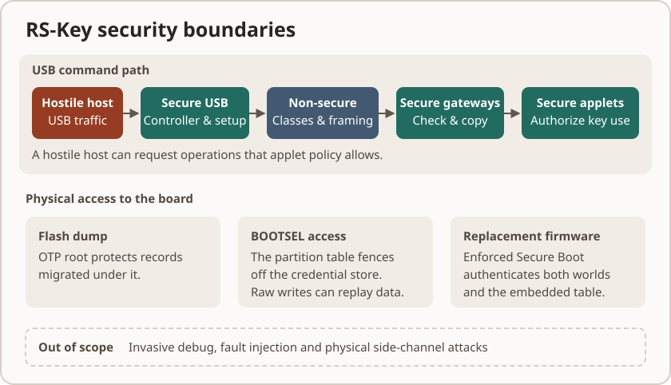
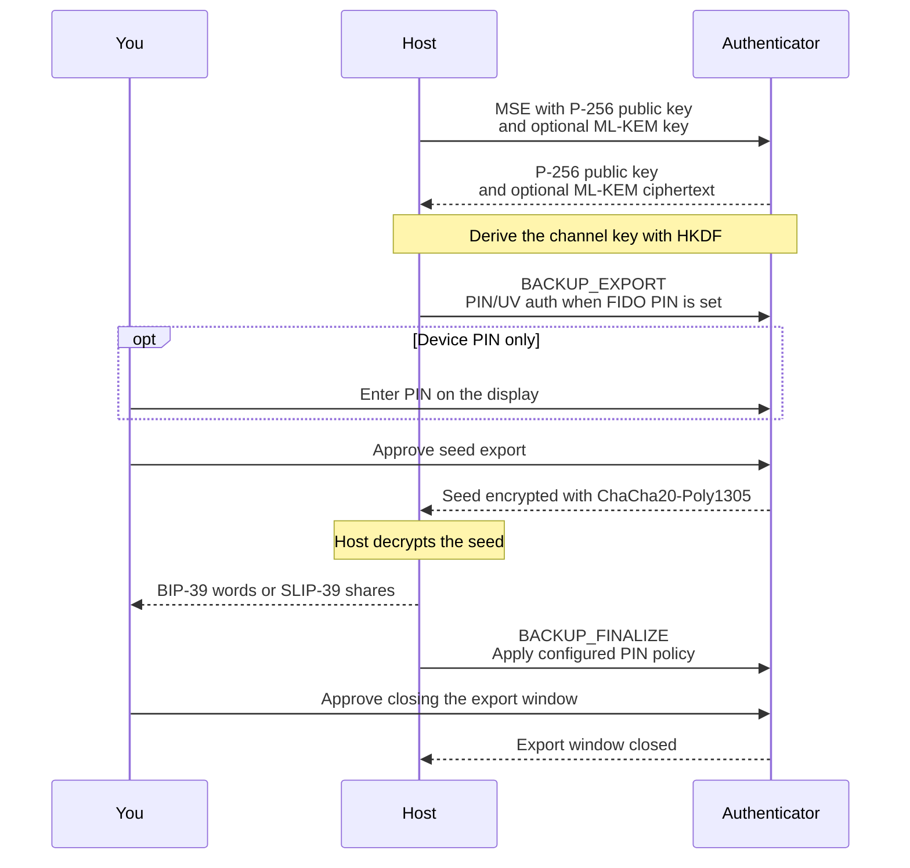

# Threat model

Assume the USB host is hostile and the Non-secure firmware can execute
arbitrary privileged code. Secure code, the boot ROM and the chip's access
controls enforce the boundary. OTP provisioning and enforced Secure Boot
address separate threats from physical access to the board.

The Secure USB driver owns the controller, handles endpoint operations and
observes hardware resets and configuration loss. It processes USB control
traffic from the host. Non-secure code handles USB classes and reassembles
commands. Checked gateways copy those commands into Secure memory, where the
worker and applets apply their own parsers and authorization rules. Non-secure
code can forge transport state, drop traffic and observe plaintext carried
through it. See [Architecture](architecture.md#trustzone) and [Testing](testing.md#trustzone-on-hardware).

## Assets

The FIDO master seed (every non-resident credential derives from it),
resident passkeys, OpenPGP private keys and their DEK chain, PIV private
keys, OATH secrets, OTP slot secrets, PINs.

## Attacker capabilities

### 1. A hostile host (malware on the computer)

USB setup requests, CTAPHID frames, CCID messages, ISO-7816 APDUs and CTAP2
CBOR all originate with the host. A compromised Non-secure image can also
submit commands directly at the gateways.

- **Memory safety.** The applet parsers and dispatch use safe Rust. The
  trusted code also includes low-level `unsafe` Rust and C, including the
  CMSE veneers and RSA arithmetic. See the [`unsafe` audit](unsafe.md).
- **Fuzzing.** Targets exercise parsers, applet dispatch and stateful command
  sequences. Coverage varies by path and profile. See [Testing](testing.md#fuzzing).
- **Protocol gates.** PINs/UV with retry counters and lockout, physical-touch
  requirements on FIDO operations and OpenPGP UIF, OATH access codes, PIV
  management-key auth.
- What a hostile host **can** do: drive any operation you have authorized
  while the device is plugged in and unlocked (sign, decrypt, assert). A
  security key authenticates *presence and possession*, not the intent of
  every byte the host sends. Touch requirements bound the rate.
- **A flash write can be interrupted, and a host picks which one is in flight.**
  The device is bus-powered with no reserve, so the supply belongs to whoever
  holds the cable or the hub port, and because the host drives every operation it
  chooses which write a cut lands in. It needs no attacker — a knocked cable does
  the same thing — but it is cheap to aim, so treat it as aimed. There is no
  transaction underneath: one applet operation is several `Fs` writes, and a cut
  lands between any two of them. What the device owes across a cut is that
  nothing comes back *weaker*: an interrupted write left the old value or the new
  one, never a third; a record committed before the cut still reads back after
  it; a delete the cut caught halfway leaves behind no metadata describing the
  value it removed; and no gate comes up softer on the next boot than it went
  down — a torn `authenticatorReset` may not drop the PIN or `alwaysUv` record
  while leaving a credential usable. Write ORDER is what buys that, chosen per
  operation and stated where the code does it: `Fs::delete` drops the metadata
  before the value, registration writes the `EF_RP` entry before the credential,
  a reset deletes the seed before anything derived from it. Underneath the order
  sits a silicon assumption that a torn NOR write leaves the old bytes or
  detectably bad ones. `PLAT-FLASH-001` remains pending a real supply-cut test
  on hardware. See [Platform assumptions](platform-assumptions.md).
  **Scope: the interrupted
  write.** A flash *read* that comes back an error is a different condition and
  has its own clause below. Not that a cut cannot produce one: a half-programmed
  item header is deterministic *and* reads back as an error, and what keeps a
  store walk honest is that it skips that error on purpose rather than never
  meeting it.
- **A flash read can come back an error, and this firmware spells "not
  configured" as an absence.** The backend answers a probe with the value, with
  *no such key*, or with a failure — and its own API folds the last two together:
  `Storage::read` and `Storage::size` return `None` for either, which is why a
  second call, `last_error`, exists to tell them apart. The fold is what makes
  this a security condition rather than a reliability one, because absence is how
  the tree spells *no PIN set*, *no gate configured* and *not provisioned yet*: a
  probe that merely failed then reads as a decision the owner never made.
  Measured, before it was fixed: one refused `EF_PIN` probe on an unauthenticated
  PIV `SELECT` re-seeded the factory PIN over the owner's, after which
  `VERIFY 123456` answered `9000` — and the same fault aimed at the
  management-key slot re-minted the default management key. What the device owes
  is that a refusal is never laundered into an answer, and three rules carry it.
  Two are owned by one function each and cited from the store's refinement: a
  failed probe is never memoised as a decided absence, so one transient fault
  cannot become a permanent "file absent" for the rest of the boot; and an
  enumeration the medium truncated leaves the keys it never reached *undecided*,
  so a walk that stopped early cannot report them gone. The third is a **per-site
  discipline and not a mechanical property, which is worth saying plainly**: a
  probe whose absent arm would overwrite configured material or open a gate is
  answered fallibly — either propagating the failure, or resolving it to the
  restrictive arm where that is the safe answer — rather than collapsing it into
  an absence. Which class a site belongs in is decided by asking what becomes
  reachable if the probe answers *absent* where the truth is *present*, and it is
  held by a test at the site; no gate can check it, and the tree carries far more
  collapsing probes than fallible ones because most absences cost only a status
  field or a repeated repair. **Scope: the read the medium refused, whoever
  caused it.** How much of a lever a host has here is deliberately not claimed. A
  cut it aims leaves a half-programmed item header that reads back
  `Error::Corrupted`, and the store walk skips that one on purpose, so it
  truncates nothing; an interrupted page *erase* leaves a marker pair the backend
  also reports as `Corrupted`, and that one does reach a per-key probe in the
  source. Whether any of it is reachable on a board is unmeasured. The three
  rules hold either way, because none of them asks who caused the refusal.
- **You must be able to see and revoke every credential the device holds.**
  Resident credentials live in `EF_CRED`, and the two surfaces that let you
  BROWSE them — `enumerateRPs` and the trusted-display Passkeys view — reach them
  through `EF_RP`. So a credential whose `EF_RP` entry is missing is one
  `getAssertion` signs with happily and neither surface will show you.
  `enumerateCredentials` and `deleteCredential` scan `EF_CRED` directly, on an
  rpIdHash the host supplies, so a caller who already knows the rp can still
  reach it: what a strand costs is DISCOVERY, and revocation only so far as
  revoking a thing means finding it first. It does not heal on its own either — a
  later registration of the same (rp, user) dedups onto the record already there
  instead of writing the missing entry (audit run-35). Registration and
  credential-management delete are therefore ordered to fail the harmless way
  round: the `EF_RP` entry is written before the credential, and the credential
  goes before the count that names it. **The resets are not, and this page will
  not pretend otherwise.** There the seed leads and the rest is swept in ring
  order, which reaches `EF_RP` before `EF_CRED` — a torn wipe can still strand a
  credential whose seed has already been removed. A power cut can also leave
  an `EF_RP` entry after its last credential is gone. On a successful
  credential scan, boot reconciles existing RP records, correcting counts
  and removing empty entries. It leaves a missing RP record missing.
- **A key must not outlive the algorithm attribute it was made under.** An
  OpenPGP slot's algorithm attribute is one `PUT DATA` away for anyone holding
  PW3, and the card reads that record again at the moment of every *private-key*
  operation: `PSO:CDS`, the asymmetric arm of `PSO:DECIPHER` and `INTERNAL
  AUTHENTICATE` take one byte of it to decide whether the slot is RSA or EC before
  they touch the key. The symmetric arms read no attribute at all: a
  `PSO:DECIPHER` body opening `0x02` and every `PSO:ENCIPHER` route to
  `EF_AES_KEY` and have returned before that read, so nothing below is about
  them. Only that byte — the curve and the modulus size come from the stored blob
  itself — so what an attribute change *under* a surviving key does depends on
  which way it goes.
  Across the families it is caught by accident: the old blob does not parse as the
  new algorithm and the operation fails. Within a family nothing catches it, and
  that is the case worth stating. Swap Ed25519 for P-256, or RSA-2048 for
  RSA-4096, and the card goes on signing and deciphering with the old key while
  `GET DATA` publishes the new parameters over it — a slot whose published
  description no longer describes the secret behind it. So what the device owes
  here is a deletion and not a validation: a `PUT DATA` of `C1`/`C2`/`C3` that
  resolves to an attribute different from the one the slot already holds drops
  that slot's private key and the stored public key it would go on serving
  *first* — whenever the store reports the slot present — and only then writes the
  new value. A key the present cache reads absent while the backend still holds it
  is not dropped, and the attribute goes in over it. Every probe on that path is
  fallible on purpose: an unreadable attribute, an unreadable key slot, or a drop
  the store refused each answer `6581` **without writing the attribute**, rather
  than skipping an invalidation the card could not prove unnecessary. And the
  internal EF the attribute lives in is not addressable — `PUT DATA` answers
  `6B00` to it even under PW3 — so the `C1`/`C2`/`C3` tags are the only door.
  **Scope: the attribute write.** A write that resolves to the attribute already
  in force is not a change and keeps the key, and an absent attribute reads as the
  RSA-2048 default on both sides of that comparison. Three things this does NOT
  claim. The fingerprint DOs are outside the drop, so a slot goes on publishing
  the old key's fingerprint in `C5` until something overwrites it. `TERMINATE DF`
  sweeps attributes and keys in flash-ring order, so a factory reset that fails
  partway can leave a key beside a cleared attribute, and what it owes there is
  the `6581` it returns rather than an order. And the binding at the other end —
  `GENERATE` and `IMPORT` reading the slot's attribute as they mint or take the
  key — is one command for every arm but the two-step RSA generate, which reads
  the attribute when it starts the prime search and does not read it again when it
  stores the key. Nothing in the applet closes that window; what closes it is the
  worker dispatching one command at a time.
- **A Yubico OTP the host watched being typed must not validate twice.** The OTP
  applet types its ticket as keystrokes into whatever has focus, so a hostile host
  reads every OTP the key emits; what stops one being replayed is not secrecy but
  position. Among the fields each press of a Yubico-OTP slot encrypts into its
  ticket is a *pair* — the slot's persisted 15-bit use counter and a one-byte RAM
  session counter — and the protocol's replay rule is that a validation server
  rejects any OTP whose pair does not exceed the last pair it saw for that public
  id. The pair is therefore the defence, and the rule is that a press emits the
  pair the slot holds and then moves it: the session counter on every press, and
  the persisted use counter whenever the session counter wraps past 255. One press
  does not read that way — the first on a freshly configured slot, whose stored
  zero is written up to one *before* the ticket is built, so what it types is the
  moved value and not the zero it held. The two paths that ADVANCE the persisted
  half are the wrapping press and a boot's first press, and the step that can
  reach the 15-bit ceiling comes from one module for both, so the ceiling cannot
  be enforced two different ways. The first-press `0 → 1` write sits beside it in
  `ticket.rs` and cannot reach the ceiling. `UPDATE` and the boot seal migration
  carry a slot's record forward and leave the counter alone. `SWAP` leaves the
  stored counter alone too — but it moves the record to the *other* slot index,
  and the RAM half travels with it, because the pair belongs to the public id
  inside the record and not to the slot number that record happens to sit at.
  Because the session counter lives in RAM and comes back at zero with every
  boot, warm or cold, the first press of a plain Yubico-OTP slot after one
  advances its persisted counter before it types, as a YubiKey advances it at its
  first use after power-up — never a HOTP, short or static slot, and never one
  already at the ceiling. That is what keeps one boot's pairs out of the next
  one's, and since only a press moves it, no reboot a host can ask for walks the
  counter toward the ceiling. Every advance's answer is read: a ticket whose
  advance the store would not take is not typed at all, because typing it
  re-emits — the next press reads the old counter back and pairs it with a
  session already used — and a press whose read the medium refused types nothing
  and leaves the advance owed. A store that keeps refusing therefore silences the
  slot until it recovers: a denial of service, where typing on would repeat.
  **Three residuals, and the rule above hides none of them.** At that ceiling
  neither path advances anything and the key goes on typing, so the pair repeats
  every 256 presses and every boot. And position is not monotone across
  re-provisioning: `CONFIGURE` writes a fresh record with a zeroed counter, gated
  by the slot access code whenever the existing slot reads back. And the move that
  carries the pair is not atomic: `SWAP` writes the two records one after the
  other and swaps the RAM halves only once both are through, with nothing to undo
  a step that failed. A refused second write answers `6581` with the first already
  landed, and so does a refused delete — the answer is read now, but where the
  record write has already gone in it buys the report and not the state. That
  direction still leaves one public id in two slots with only one of the two
  session halves its own, and the other slot can then type a position that id has
  already typed this power cycle — which a plain `ykman otp swap` reaches
  unauthenticated, an unprotected slot's stored access code being all-zero.
- **Device config is UNGATED on the default build.** The shipped default is the
  full-ykman/YubiKey-compatible admin surface: a hostile USB host can silently
  rewrite the DeviceInfo / enabled-applications / USB identity — over CCID
  Management `WRITE CONFIG`, the FIDO vendor `CONFIG_WRITE`, and the CTAPHID
  (`0x43`) and OTP-HID (`0x15`) transport writes — with **no** touch or PIN.
  A configuration lock code (`ykman config set-lock-code`) closes the DeviceInfo
  half, as on a YubiKey: once one is set, all four writes need it
  ([protocol.md §6.2](protocol.md#62-configuration-lock)). It keeps no retry
  counter, a YubiKey keeping none either, so a code a person could remember can be
  guessed online — use `--generate`. It shuts RS-Key's own phy and LED records
  too, which no code opens: they change only once the lock is cleared. The
  USB *identity* (serial, strings) is cosmetic — never proof a device is genuine,
  attestation is (§3). The **enabled-applications mask is enforced**, though: a
  disabled application's applet stops answering (PIV/OpenPGP/OATH/OTP over CCID,
  FIDO2/U2F over **both** CTAPHID and CCID, the OTP keyboard), so a hostile host
  can turn one off.
  That is a **reversible denial-of-service**, not a confidentiality or integrity
  break — the Management applet, the FIDO vendor command, and the OTP-HID
  identify/config slots are never gated by the mask, so any single transport can
  re-enable it (with the code, once a lock is set), and no secret is exposed.
  **A lock code the attacker set would end that**, so setting one where none is
  set takes a touch of the key, on all four writers, where a YubiKey 5.8.0 asks
  none: with a code nobody holds, nothing turns an application back on, and the
  display build's factory reset or an `rsk-wipe` erase, both of which destroy
  every credential, is the only way back. What is left is a touch given to the
  wrong prompt, since the BOOTSEL button cannot show what it approves; setting a
  code of your own at provisioning closes that too, as changing one needs the
  current one. **Reversible describes the mask, not the flash it is
  written to.** Repeated changes to persistent configuration consume flash
  endurance. The vendor and FIDO paths skip unchanged records, while a host
  can still send distinct values. Wear depends on the workload and flash
  geometry. If you need config writes gated on the operator,
  build/flash **`firmware-strict-config`**, which restores the presence/PIN gates
  and refuses the ungated transport writes ([build.md](build.md)). It is not the
  runtime flash flag `EF_HARDENED`.
- **The FIDO applet answers on two transports, and the second one is easier to
  reach.** CTAP2 and U2F are served over CCID as well as CTAPHID
  ([CTAP over CCID](protocol.md#53-ctap-over-ccid)), so any process that can talk
  to `pcscd` can drive the whole CTAP surface — no exclusive HID handle, and none
  of the platform gatekeeping a browser or the Windows WebAuthn stack applies to
  its own FIDO path. **What that does and does not buy an attacker:** nothing a
  credential gate would have stopped. Every operation still spends the same PIN,
  the same pinUvAuthToken and the same physical touch, because the two transports
  run the *same* applet over the **same `FidoState`** — one PIN/UV token, one
  credential-management walk, and crucially **one** per-boot PIN-mismatch budget.
  A second session state would have handed a host `PIN_MISMATCH_LIMIT` guesses per
  transport instead of per power cycle, which is the restart-by-reboot attack
  §6.5.5.6 exists to stop; that it is shared is enforced by construction (one
  `&RefCell<FidoState>` reaches both) and pinned by
  `both_transports_answer_from_one_session_state`. What it *does* buy is
  **reachability**: a process that could not open the HID device can now open the
  card. Treat FIDO as available to anything with card access, and use
  `ykman config usb --disable fido2` (or `--disable u2f`) if that is not wanted —
  the mask gates the two applications apart, over both transports. Client or
  driver binding can affect reachability on a particular host. Treat CCID as
  exposed whenever the interface is enabled.
- **User intent.** A button confirms presence. Malware can substitute its own
  request before you press it. In a FIDO presence prompt, the trusted display
  shows the RP ID that the authenticator received and lets you approve or
  decline on the device. A deliberate approval applies to that prompt. A
  stale touch, Deny, cancellation or timeout cannot approve it. Compare the
  RP ID with the site you intended to use. The browser and relying party still
  determine whether an assertion is valid for the origin and challenge.
  Silent `up:false` assertions can still run when policy permits and return
  with UP clear. See the [trusted display guide](guides/display.md).

With the default presence policy, an eligible `up:false` assertion can
return `largeBlobKey` without interaction when the credential's
`credProtect` policy permits it. `alwaysUv` applies to requests with UP
set, and `strict-up` adds a presence check to silent probes. A host can
read the ciphertext array with `authenticatorLargeBlobs get`. The optional
`largeblob-ext` build can return the blob itself on an eligible read and
seals it at rest under a seed-derived key with the credential ID as
associated data. See the [CTAP specification](https://fidoalliance.org/specs/fido-v2.3-ps-20260226/fido-client-to-authenticator-protocol-v2.3-ps-20260226.html).

### 2. A thief with the powered-off device (at-rest)

- **Secret records.** The FIDO seed, attestation scalar and persistent UV
  token use ChaCha20-Poly1305. PIV keys and OATH and OTP secret records use
  AES-256-GCM. Their keys derive from the device root `kbase`. OpenPGP private
  keys use a separate AES-256-GCM data-encryption key (DEK) wrapped under
  PIN-derived keys. The store also authenticates record authority and contents.
  Before OTP, that authority uses the public serial root. The completed latch
  requires OTP-backed authority. A flash image can still contain public metadata.
- **OTP master key.** Before provisioning, `kbase` derives from the public chip
  serial. A flash dump and that serial let an attacker recover device-sealed
  records and try guesses offline against legacy PIN verifiers. After
  migration under a fused MKEK, recovery from flash alone requires that MKEK.
  A PIN-derived record can stay on the public root until its PIN or resetting
  code is presented. See `PLAT-THREAT-002` and [Production setup](production.md#stage-1--otp-master-key).
- **Page-58 latch.** Before the latch, a raw flash writer can plant a record
  under a public pre-OTP key that migration would then re-seal under the
  fused root. Secure startup completes the latch after the migration checks
  pass and a fresh flash scrub succeeds. The completed lock denies BOOTSEL
  and Non-secure access and leaves Secure firmware read-only access. A
  per-boot software lock already denies Non-secure access before the launch
  of Non-secure firmware. See [OTP fuses](otp-fuses.md).

  After the latch takes effect, device-sealed records covered by migration
  reject the pre-OTP and legacy cleartext formats. An unreadable fused root
  fails closed. Older locks that leave Secure writes enabled still need the
  current startup checks to complete the latch. PIN verifiers keep their
  pre-burn arm because their format does not identify the root. This includes
  the FIDO PIN, the display's device PIN, the PIV PIN and PUK, OpenPGP's PW1,
  PW3 and resetting code with their DEK copies, and the OATH OTP PIN. The
  fallback is a property of the verifier format. Changing a verifier in the
  authenticated store also requires a record and authority that the store
  accepts. A substituted PIN verifier by itself cannot unwrap the OpenPGP DEK.
  An unreadable fused MKEK blocks boot migration and is reported by
  READ `1E/07` as `FFFE`.
- **Soft-lock.** The seed is wrapped with ChaCha20-Poly1305 under a 32-byte
  key supplied by the user. Operations that need the seed remain locked until
  that key is presented over an encrypted channel. A successful unlock keeps
  the seed in Secure RAM for use until it is cleared. See the [Soft-lock guide](guides/soft-lock.md).
- Caveat: superseded records linger. The flash log is append-only, so
  re-sealing or deleting a secret leaves the old copy on flash until its page
  is reclaimed. Two cases differ in how much that matters:
  - The **OTP-burn migration** supersedes the *pre-OTP* seed, which was sealed
    under the chip-serial-only root (no fuse secret), and the persistent `pcmr`
    grant, which provisioning mints at the first boot under that same root. Left
    alone, a flash dump plus the chip id would recover them, bypassing the burn.
    Boot runs a compaction lap before USB attach. Migration re-arms the
    `EF_HARDENED` marker when it replaces a record. Sealing page 58 requires
    successful migration and a fresh scrub, so an interrupted pass can leave
    the migration pending on a later boot.
  - The **soft-lock** transition leaves the same kind of lingering record, but
    on a provisioned device it is already sealed under the fused root (moot
    against anything short of a fused-key compromise), so soft-lock's at-rest
    guarantee simply hardens over time as natural compaction overwrites it.
- **FIDO seed and PIN.** The current seed format uses the device root so
  UP-only operations such as U2F can work from a cold boot. The FIDO PIN
  controls use where policy requires UV. Soft-lock adds a separate wrapping
  key supplied by the user.

### 3. An attacker who can flash their own firmware

- **Secure Boot.** When enforced, the boot ROM authenticates the complete
  combined image, including both worlds and the embedded partition table,
  using the enabled signing keys. The production procedure also provisions
  debug restrictions and glitch detectors. See [Production setup](production.md).
- **Anti-rollback** ([anti-rollback.md](anti-rollback.md), optional): with
  `ROLLBACK_REQUIRED` fused, images below your board's rollback floor (or
  carrying no version at all, i.e. anything sealed before the feature) no
  longer boot. A kept copy of an old signed release with a since-fixed bug
  stops being a downgrade path.
- Before secure boot is enabled, this attacker wins against the OTP tier:
  their firmware reads the MKEK exactly like ours does. That is why the
  production page calls the two stages one story.
- The **USB/smartcard identity** (VID/PID, manufacturer, product, OpenPGP AID
  vendor) is fully host-configurable at runtime via the phy record and is not an
  authenticity signal: a phy write that sets the Yubico VID makes a stock key
  present a full Yubico identity, and the manufacturer/product strings are also
  settable outright (phy tags `0x0F` / `0x09`), so any VID can carry any vendor
  name. On the **default build these config writes are ungated** (no touch, no
  PIN — see §1); `firmware-strict-config` re-gates them. Treat the identity as
  cosmetic, never as proof a device is genuine — attestation (device-key / org
  cert) is the authenticity mechanism, and it is unaffected by any config write.

### 4. Physical / lab attacks — OUT OF SCOPE

Decapping, microprobing, advanced fault injection beyond the RP2350's glitch
detectors, power/EM side channels, and the **XIP TOCTOU**: interposing on the
QSPI bus to serve the genuine image to secure boot's verifier and a tampered one
to the CPU, since nothing binds checked bytes to executed bytes and the image is
too large to verify-in-place from SRAM. An in-package-flash part (RP2354) leaves
no discrete flash chip to tap, raising a reliable swap to decap-class effort. The
RP2350 is not a secure element and RS-Key does not pretend otherwise. If your
threat model includes a funded lab, buy a certified key.

**One residual straddles this line, and it is written down rather than left to
the reader.** The RSA private operation picks a modexp window per four bits of
`dP`/`dQ`, and the choice lands in an ADDRESS: PIV GENERAL AUTHENTICATE and
OpenPGP PSO:CDS / INTERNAL AUTHENTICATE / DECIPHER all drive it over USB against
a long-lived key, and the per-operation blinding randomises the base, never the
exponent. Reading the window sequence back needs a time-resolved look inside a
single operation, and the only observer holding one is the power/EM capture
already listed above — so that half is out of scope for the reason this section
already gives, not for a new one. The other half is not out of scope: a host that
can time whole operations is the §1 attacker, and against it the pattern is one
scalar per signature over an exponent that never changes. Severity, the reasoning
and what would re-open it are registered as `PLAT-CRYPTO-002`, and the hardening
that would remove it is `PLAT-BUILD-005`, deferred with a stated price
([platform-assumptions.md](platform-assumptions.md), [ct-audit.md](ct-audit.md)).
This paragraph adds a residual to the page; it excludes no observer the section
did not already exclude.

### 5. Network

The firmware exposes its interfaces over USB. Network-originated input
reaches the device through host software.

## Flash snapshot rollback (the PIN-counter reset)

Reported by Token2 ([issue #37](https://github.com/TheMaxMur/RS-Key/issues/37),
[advisory PDF](https://github.com/user-attachments/files/30152894/T2-SA-RP2350-Dec2025.pdf)).
An attacker with physical access and a way to read and rewrite the store can
save the flash, submit PIN guesses to the device and restore the saved copy
when the retry budget runs out. This repeats on-device guesses. It can reset
flash-backed counters for FIDO PIN, PIV PIN/PUK, OpenPGP PINs and the OATH
OTP PIN. The attack also needs a reboot that clears any separate per-boot
retry state.

An old record and its matching store authority can still authenticate on
the same chip. The main directory tracks the newest authority it has seen
within the same backend instance, including remounts. Replaying all its
authority copies after a cold boot can still restore older state. The counter
partition has a separate authority. Replaying both of its banks can rewind counters without changing
KVMAIN, even while the main directory remains mounted. Firmware
anti-rollback applies its floor to the image. A retry budget needs durable
freshness of its own, which the current store has no independent way to
check. See [Limitations](limitations.md) and [Anti-rollback](anti-rollback.md).

- **Partition table.** The default build embeds an RP2350
  partition table that fences the KV store off from the USB bootloader. `picotool save` and
  `picotool load` over that range answer `permission failure` — enforced by the bootrom, not
  by us — while the running firmware keeps `secure: rw` and full access to its own data. The
  default BOOTSEL path rejects those direct store reads and writes. The
  diagnostic `--no-partition-table` build omits that fence.

  With Secure Boot enforced, altering the table in a signed image breaks
  image authentication. An older image signed by an accepted key can still
  replace the fence if the rollback policy allows it. Without enforcement,
  an attacker can install their own image with a permissive table. The fence
  covers BOOTSEL access to the store. Direct flash access can bypass it.
- **OTP-seeded PIN verifier.** A FIDO PIN verifier created or migrated under
  the fused root derives from `HKDF(serial_hash, HMAC(kbase, pin))`. A flash
  dump alone lacks the MKEK needed to check guesses against that verifier.
  Legacy verifiers that still use the public root retain their offline risk.
- **`strong-pin` / `fips-profile` builds** (opt-in). Raise the clientPIN floor to six code
  points and reject common patterns such as repeated digits and `123456`.
  This raises the cost of guessing, which still depends on the chosen PIN
  and the attacker's access. See [Build options](build.md).
- **Soft-lock** (opt-in). The FIDO seed is wrapped under a key only you hold
  ([guides/soft-lock.md](guides/soft-lock.md)), so a brute-forced PIN yields nothing until you
  present it. It covers the FIDO seed; the PIV, OpenPGP and OATH counters stay
  rollback-resettable.

The durable defense on a general-purpose MCU is PIN entropy, plus the soft-lock second factor
for the FIDO seed. A device left in an attacker's hands, protected only by a short PIN, is not
safe here. This is the same boundary as ["anyone with the device and your PIN is
you"](limitations.md).

## Platform silicon: the RP2350 security challenges

Raspberry Pi has publicly stress-tested the RP2350 die. The results bound
RS-Key's physical-attack posture.

**Challenge 1 broke the A2 stepping** ([results][c1]). The task was to extract an
OTP secret from a board running secure boot. The winning attacks:

- **Aedan Cullen**: voltage glitch on the `USB_OTP_VDD` rail, reading OTP
  secrets out of the guarded path (erratum E16) ([writeup][cullen], [talk][c38c3]).
- **Marius Muench**: a glitch plus a boot-ROM flaw, bypassing secure boot to run
  unsigned code.
- **Kévin Courdesses**: laser fault injection corrupting the boot-time signature
  check (erratum E24) ([writeup][courk]).
- **IOActive**: focused-ion-beam (FIB) plus passive voltage contrast (PVC),
  reading the antifuse array directly: the bitwise OR of two physically paired
  bitcell rows ([writeup][ioactive]).

The first three are comparatively cheap fault / boot-ROM attacks. The IOActive
readout needs FIB-class lab equipment (a tool worth hundreds of thousands of
dollars, one to two days per target) and applies to *every* device built on the
Synopsys `dwc_nvm_ts40*` antifuse IP on TSMC's 40 nm node, an antifuse property,
not an RP2350-specific defect.

**A4 addresses the original fault and boot-ROM attacks.** It replaces the
affected boot ROM and changes the OTP power-glitch circuitry. The direct
antifuse readout remains applicable. RS-Key uses OTP chaff to address the
demonstrated paired-row readout. Raspberry Pi's second challenge targets
side channels in the boot ROM's AES implementation. See the [A4 announcement][a4],
[second challenge][c2] and [OTP fuses](otp-fuses.md).

**A4 does not stop a laser from turning debug back on** ([Ledger Donjon][donjon]).
On a decapped A4, photon-emission imaging located the `DEBUGEN` register and
laser pulses set the bits that restore Secure debug, despite
`CRIT1.DEBUG_DISABLE` and `DEBUGEN_LOCK`; a rescue reset then stops the chip in
the boot ROM before any firmware runs, and the OTP reads out. About $250k of
equipment. Raspberry Pi will not respin: the attack is destructive, and with
per-device keys it has single-device scope ([response][rpi-laser]).

**What this means for RS-Key.** The project has board records from A2 and A4.
The Donjon experiment read its challenge secret from page 48. It also shows
why an attacker who restores Secure debug could read RS-Key's MKEK and DEVK
on page 58. Our completed latch still permits Secure reads, and a logical
debug read can recover the real rows despite chaff. That application to
RS-Key follows from the access policy. The published experiment used the
challenge firmware. A recovered MKEK exposes device-sealed records from that
board and enables offline PIN guessing against verifiers derived from it.
A soft-locked seed still depends on its separate off-device key while it is
locked. An organization attestation key shared across a fleet can extend the
impact beyond one device. See [Ledger Donjon][donjon], [Testing](testing.md#trustzone-on-hardware)
and [Attestation](guides/attestation.md).

[c1]: https://www.raspberrypi.com/news/security-through-transparency-rp2350-hacking-challenge-results-are-in/
[a4]: https://www.raspberrypi.com/news/rp2350-a4-rp2354-and-a-new-hacking-challenge/
[c2]: https://www.raspberrypi.com/news/rp2350-hacking-challenge-2-less-randomisation-more-correlation/
[cullen]: https://github.com/aedancullen/hacking-the-rp2350
[c38c3]: https://media.ccc.de/v/38c3-hacking-the-rp2350
[courk]: https://courk.cc/rp2350-challenge-laser
[ioactive]: https://www.ioactive.com/raspberry-pi-2350-hacking-challenge/
[donjon]: https://donjon.ledger.com/blog/rp2350-secure-debug-laser-fault-injection/
[rpi-laser]: https://www.raspberrypi.com/news/everything-is-better-with-lasers/

## Seed backup (the deliberate exception)

Host export sends the FIDO seed over an ephemeral channel using P-256 ECDH,
HKDF and ChaCha20-Poly1305. The channel can add an ML-KEM-768 shared secret.
The export request also requires presence and authorization with the
configured PIN. While the export window is open, export can be repeated.
`finalize` requires a separate authorization and closes the window until a
factory reset. The `fips-profile` build refuses export.

The PIN factor has **two** forms and the second is easy to miss: with a clientPIN
set it is the PIN/UV token; with no clientPIN but a **device PIN** set, the same
gate collects that PIN on the device's own pad, so a display-flavor key whose
owner never set a clientPIN is still two-factor. With neither set there is no PIN
factor and the gate is the encrypted channel plus a touch — which is the state a
factory-fresh key is in, and the reason `finalize` exists. A device PIN the
running build cannot collect (the record survives a reflash to a screenless
image, which has no pad) is **refused**, not waived: an owner who set a PIN does
not silently drop to a touch. Restore re-seals
the seed under the *destination* chip's root. The host driving a backup
necessarily sees the seed plaintext. Do it on a machine you trust.
Scope: the deterministic identity only (resident passkeys, OpenPGP, PIV are
not covered).

On the **trusted-display flavor** the host need not be in that trust path: the
device can render BIP-39 words or SLIP-39 shares **on its own screen** (the seed is
turned into words on-device and never crosses USB), so a backup can be taken
without trusting any host. That trades the host-observation surface for a
physical/visual one. The words are briefly on the panel (shoulder-surf, camera).
It is gated to keep that surface small: it requires a **device PIN** set and
re-entered, a deliberate hold past an explicit "no one watching" warning, runs
only inside the same one-time window (and seal closes it), is disabled on the
`fips-profile` (non-exportable) build, zeroizes the seed/words from RAM on exit,
and auto-clears the panel after a short idle.

## Zeroization

Session teardown wipes PIN/UV tokens. Transient copies in `Secret` or under a
`WipeGuard` are wiped when their scopes end, including error returns. The
firmware also scrubs transport and exchange buffers at their reuse or
revocation points. Non-secure code can observe a plaintext PIN sent over
CCID before the buffers are scrubbed. Secure startup and operations that
need the MKEK or DEVK read the fused keys on demand into temporary buffers.
Secure code execution can call the same OTP readers.

Accepted residuals: `Copy` temporaries inside RustCrypto curve arithmetic and
digest internals, in stack slots until the work that made them is done: core0's
dead stack is zeroed after each request, keyboard OTP frame, typed ticket and
panel flow, and core1's after each prime search (`firmware/src/sweep.rs`). The
few hundred bytes above the shallowest of those callers — the tasks' own poll
frames, interrupt frames taken while the worker idles — no sweep reaches. The
working buffers `num-bigint-dig` allocates inside its own
arithmetic — a division's, a modular inverse's, a modular exponentiation's — it
frees unwiped; `rsk-rsa` holds a key's values, its blinding values and a private
operation's result and intermediates in a `Secret` or a key type whose `Drop`
wipes them, except the primes and `d` of a key `RsaKey::from_p_q` refuses. The
heap closes both for what it holds: it wipes each block as it frees it
(`ZeroingHeap` in `firmware/src/main.rs`), so a freed buffer's bytes do not
outlive the free. A `num-bigint-dig` value of eight limbs or fewer is held inline,
not on the heap, and a local one stays in its stack slot like those temporaries.

The root `clippy.toml` restricts direct uses of `Zeroize::zeroize` and
`Zeroizing`. A state object that needs its own wipe uses an `#[expect]` at
the wipe site. A panic halts without unwinding, so a key unsealed at that
point can remain in SRAM. Moving a secret can also leave compiler copies.
Firmware builds secrets in place and passes them by reference where possible.

Reboot to BOOTSEL requires presence and leaves BOOTSEL in control of any
remaining SRAM. `worker::reboot` wipes live key material before handing off.
In the recorded RP2350 A4 test with Secure Boot off, all 520 KiB of main SRAM
read back as zeros. A known pattern written through PICOBOOT read back
correctly, which confirms that the zero read was a measurement. The result
applies to the tested silicon and boot policy. It measures the platform's
clearing behavior. See `PLAT-MEM-001` in
[Platform assumptions](platform-assumptions.md) for the board record.

Firmware-requested resets go through `worker::reboot`. `clippy.toml` refuses `SCB::sys_reset`,
`rom_data::reset_to_usb_boot`, `rom_data::reboot` / `reboot_ns` and
`Watchdog::trigger_reset` anywhere else, so a new path to a reset cannot skip the
wipe without an `#[expect]` that says why. Not covered, and none of it in the
tree today: a watchdog started and left unfed (`Watchdog::start`), a raw write
to the watchdog or power-manager registers through `rp_pac`, an `AIRCR` write
through `SCB::PTR`, a ROM function called through its `ptr()`, and the ROM's
`chain_image`.

## Supply chain & process

- `scripts/check.sh` runs `cargo audit`, `cargo deny` and Gitleaks. The
  pre-commit hook scans the staged diff with Gitleaks and runs formatting,
  build and lint checks.
- Dependencies are pinned in the workspace lockfiles. Firmware Git
  dependencies come from `embassy-rs`. The emulator has its own `picoem` pin.
- **Advisory exceptions.** `deny.toml` lists exceptions for unmaintained or
  deprecated dependencies. The firmware uses `rsk-rsa` for RSA private-key
  operations. The signing and deciphering paths blind the base on each
  operation. See the [constant-time audit](ct-audit.md) for scope and residuals.

## Post-quantum notes

FIDO2 credentials support ML-DSA-44 (COSE −48), ML-DSA-65 (−49) and
ML-DSA-87 (−50). `rsk-mldsa` uses hedged signing with 32 fresh DRBG bytes per
signature and checks the implementation against NIST ACVP vectors. The
constant-time analysis and stack measurements have their own scope. See the
[constant-time audit](ct-audit.md) and [image testing](testing.md#the-image-itself----image).

The vendor MSE channel uses ML-KEM-768 alongside P-256 when the client
supplies an encapsulation key. The standard CTAP PIN/UV protocols use their
own key agreement. See the [MSE protocol](protocol.md#91-the-mse-channel-0x41--0x01).

## Reporting

This is an experimental hobby project. If you find a security issue, please
report it privately to the maintainer rather than opening a public issue.
